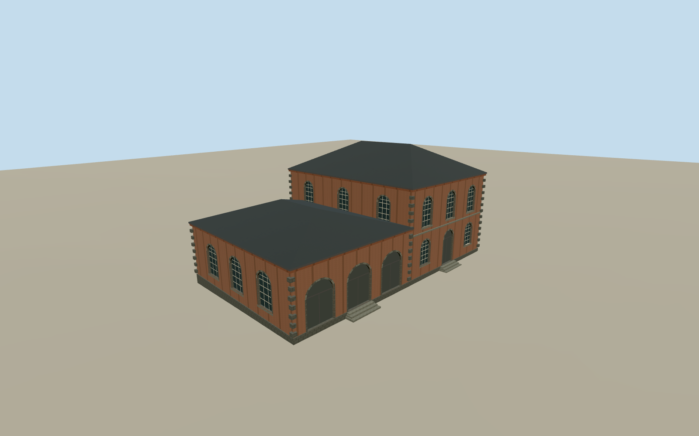

# Western Springs Pumping Station

The heritage records identify red brick, dressed basalt quoins and openings, round-arched multi-pane windows, cornices, entrance steps, hipped roofs, and broad arched boiler-house doorways.

Authoring state: **review-in-qa.json**. Current completion evidence is in [qa.json](qa.json) and the [completion ledger](../../../../qualla-structures/batches/qualla-003.PROGRESS.md).

- [Museum of Transport and Technology](https://qualla.com/museum-of-transport-and-technology/)

Wall and roof heights, window spacing and the connecting wall are approximate. The municipal illustration gives overall massing. The written heritage survey supplies opening and material details.

The current terrain remains unchanged. The DEM-derived approach and foundations give approximate vertical fit. The height of the now-demolished chimney is part of the historical record.

Build: `node content/worldgen/source/places/rc/rck/western_springs_pumping_station_auckland/models/generate-western-springs-pumping-station-auckland.mjs`. Add `--check` to verify exact regeneration. 4125 triangles; 4 materials; no embedded photographs.
