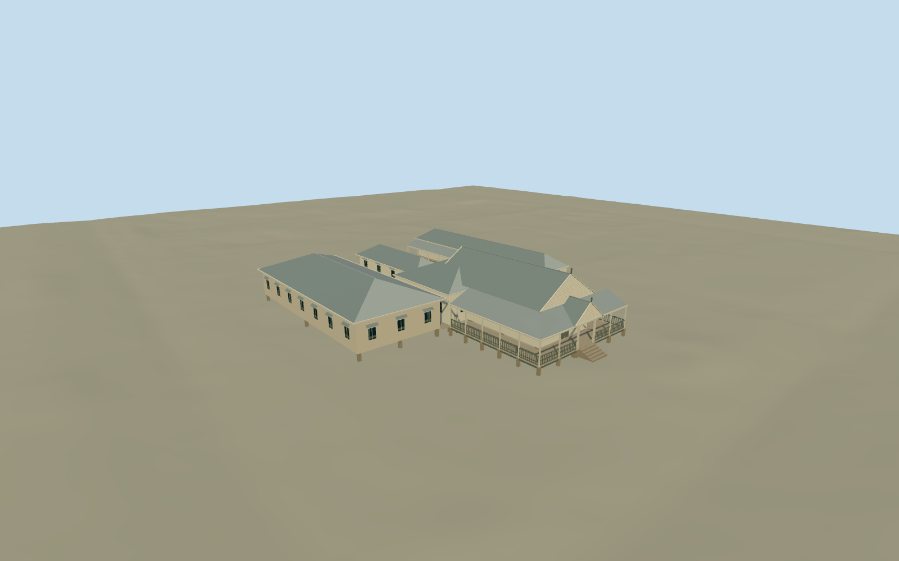

# Cloncurry Courthouse

Raised timber Cloncurry Courthouse with its double gables, deep verandas and corrugated iron roofs over several building phases.

Authoring state: **review-in-qa.json**. Current completion evidence is in [qa.json](qa.json) and the [completion ledger](../../../../qualla-structures/batches/qualla-003.PROGRESS.md).

- [Cloncurry Courthouse](https://qualla.com/cloncurry-courthouse/)

This interpretation uses the current roof outline and the 1907 elevation and ground plan. Current paint, stair profile, minor veranda infill, annex heights and glazing are approximate.

Only the heritage courthouse complex is modeled. Detached outbuildings outside the courthouse outline and interior furnishings are outside scope.

Build: `node content/worldgen/source/places/rh/rh7/cloncurry_courthouse/models/generate-cloncurry-courthouse.mjs`. Add `--check` to verify exact regeneration. 6918 triangles; 5 materials; no embedded photographs.
