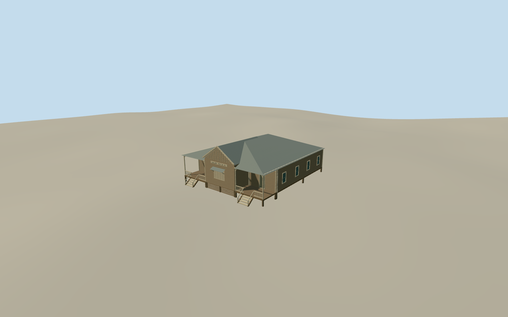

# Cloncurry Post Office

The raised timber Cloncurry Post Office around 1910, with a central slatted gable, twin public porches, paired steps and corrugated hip roof.

Authoring state: **review-in-qa.json**. Current completion evidence is in [qa.json](qa.json) and the [completion ledger](../../../../qualla-structures/batches/qualla-003.PROGRESS.md).

- [Cloncurry Post Office](https://qualla.com/cloncurry-post-office/)

This represents the original timber office around 1910. The present-day footprint is a broad site control. Historical depth, rear openings, porch lattice details and structural members are approximate.

The photograph is monochrome and partly obscured. Timber, trim and roof colors are estimates. The separate former office used as a residence and later exchange additions are outside this model.

The original public elevation field remains unchanged. Foundation, floor and stair contact are approximate.

Build: `node content/worldgen/source/places/rh/rh7/cloncurry_post_office/models/generate-cloncurry-office.mjs`. Add `--check` to verify exact regeneration. 3443 triangles; 5 materials; no embedded photographs.
