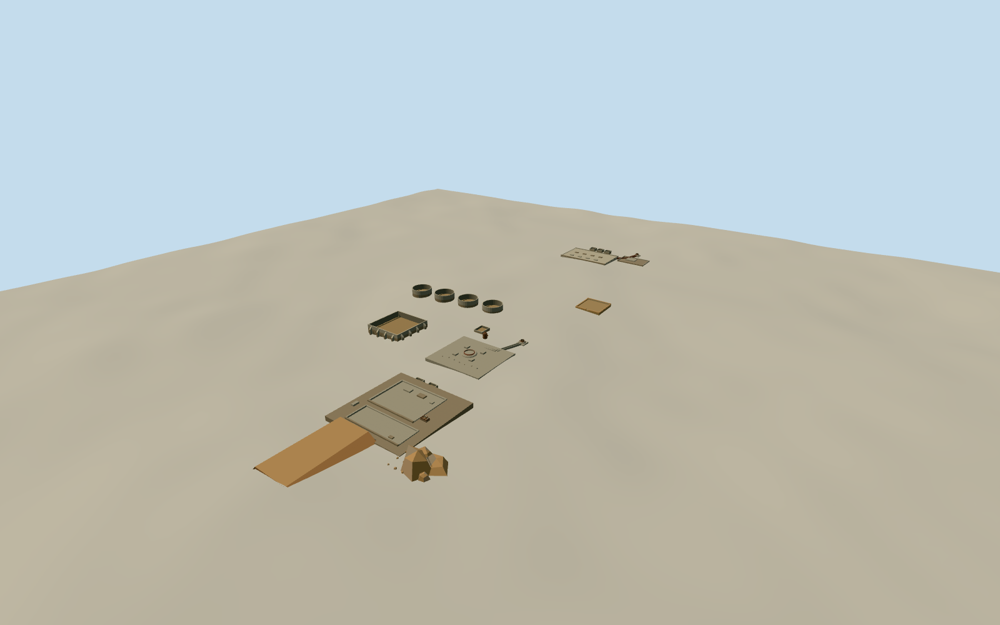

# Mount Elliott Company Metallurgical Plant and Mill

Surviving concrete vats, industrial foundations, flues and the low assay laboratory remains of the Cloncurry electrolytic copper treatment works.

Authoring state: **review-in-qa.json**. Current completion evidence is in [qa.json](qa.json) and the [completion ledger](../../../../qualla-structures/batches/qualla-003.PROGRESS.md).

- [Mount Elliott Company Metallurgical Plant and Mill](https://qualla.com/mount-elliott-company-metallurgical-plant-and-mill/)

This is an exterior reconstruction of the documented archaeological remains of the Cloncurry treatment site. Equipment and the dimensions of the large vat, four round vats and three northern tanks follow the register. The present state is approximated from the documented remains and original terrain.

Individual footprints within the surveyed heritage boundary, excavation levels, surviving adobe course counts, debris, flue sections and fitting dimensions are estimates. The developed geometry reflects five surviving groups, with the roofs and full operating machinery omitted.

The published Qualla historical hero has conflicting recorded and current renditions, and the modern tank photograph requires attribution. No photograph or aerial imagery was adopted as a modeling reference.

Build: `node content/worldgen/source/places/rh/rh7/mount_elliott_company_metallurgical_plant_and_mill/models/generate-mount-elliott-mill.mjs`. Add `--check` to verify exact regeneration. 4748 triangles; 5 materials; no embedded photographs.
