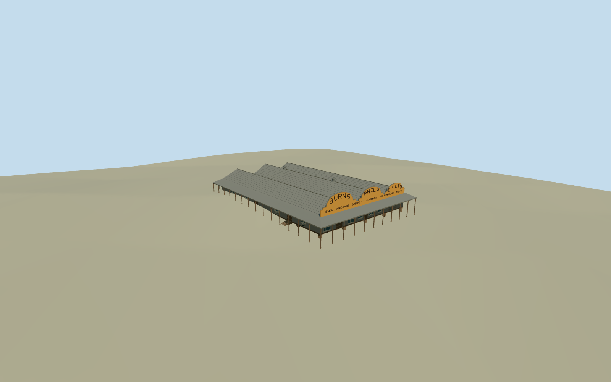

# Burns Philp Building, Normanton

The Normanton Burns Philp store’s curved merchant parapet, three corrugated roofs, elevated timber floor and long covered street edges.

Authoring state: **review-in-qa.json**. Current completion evidence is in [qa.json](qa.json) and the [completion ledger](../../../../qualla-structures/batches/qualla-004.PROGRESS.md).

- [Burns Philp Building, Normanton](https://qualla.com/burns-philp-building-normanton/)

Draft exterior: approximate photographic proportions and simplified ornament. It is not a survey, photogrammetric reconstruction or approved current geographic replacement.

Queensland Heritage Register entry 602781 specifies the raised floor, roof valleys, central ridge ventilators, window and door stations. The original photograph provides the three decorated parapet curves and profile of the projecting street awnings.

Terrain sampling/contact, geographic alignment and site activation remain pending. Runtime LODs are produced by the registered after-import pipeline and require visual review.

Reference photos remain in the local Qualla corpus; only provenance, paths and hashes are retained here.

Build: `node content/worldgen/source/places/rh/rhu/burns_philp_building_normanton/models/generate-burns-philp-building-normanton.mjs`. Add `--check` to verify exact regeneration. 8206 triangles; 6 materials; no embedded photographs.
