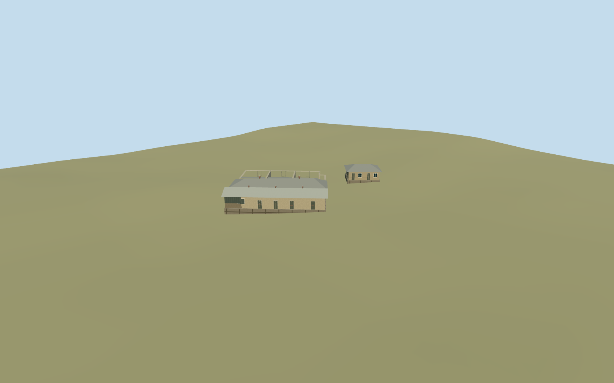

# Normanton Gaol

Standing concrete Normanton Gaol at Haig Street: open exercise yards, low iron roofs and rear timber trackers’ quarters.

Authoring state: **review-in-qa.json**. Current completion evidence is in [qa.json](qa.json) and the [completion ledger](../../../../qualla-structures/batches/qualla-003.PROGRESS.md).

- [Normanton Gaol](https://qualla.com/normanton-gaol/)

The two roof envelopes come from QRA mapping. The exact exercise yard divisions, core and annex roof breakpoints, porch depth and entrance positions are reconstructed from written facts.

Roof elevations and paint are estimates. Interior fabric, furnishings and proposed park additions are outside scope.

Original terrain stays unchanged; door thresholds and foundation elevations are approximate.

No reference imagery was used. The archive candidate is excluded because its applicable rights are unresolved, and the other candidate does not depict this property.

Build: `node content/worldgen/source/places/rh/rhu/normanton_gaol/models/generate-normanton-gaol.mjs`. Add `--check` to verify exact regeneration. 2036 triangles; 8 materials; no embedded photographs.
