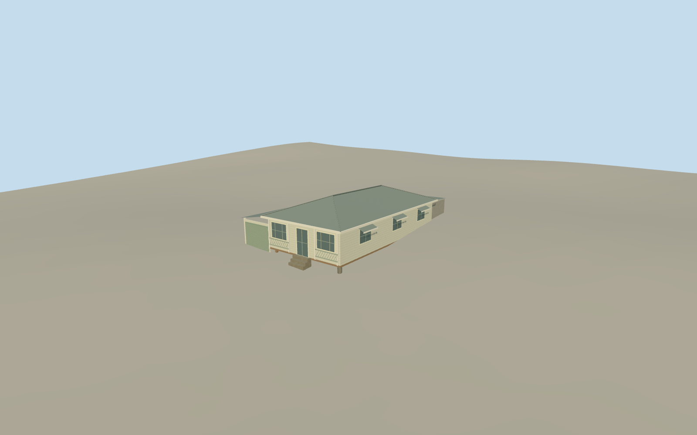

# Xavier and Sadie Herbert's Cottage

Small weatherboard-pattern cottage on low stumps, with a corrugated hipped roof, enclosed verandahs, front lattice and attached skillion carport.

Authoring state: **review-in-qa.json**. Current completion evidence is in [qa.json](qa.json) and the [completion ledger](../../../../qualla-structures/batches/qualla-003.PROGRESS.md).

- [Xavier and Sadie Herbert's Cottage](https://qualla.com/xavier-and-sadie-herbert-s-cottage/)

The land parcel, front building width and orientation derive from native mapping. The original cottage roof overlaps a long mapped outline. The residential and rear service bounds interpreted from the heritage text, cladding colors and exact dimensions are approximate.

The model includes the main cottage, attached verandahs, adjacent carport and rear block room. The separate guest garage, precinct buildings and demolished writer’s shed are outside this structure.

Build: `node content/worldgen/source/places/rh/rhz/xavier_and_sadie_herbert_s_cottage/models/generate-xavier-and-sadie-herbert-s-cottage.mjs`. Add `--check` to verify exact regeneration. 1546 triangles; 5 materials; no embedded photographs.
