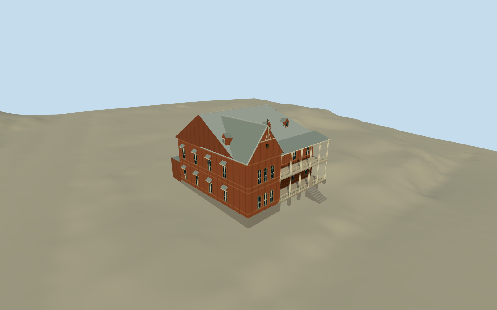

# Cooktown Museum

Cooktown’s Victorian Gothic former convent with red brick, a steep iron roof and the five-bay double veranda.

Authoring state: **review-in-qa.json**. Current completion evidence is in [qa.json](qa.json) and the [completion ledger](../../../../qualla-structures/batches/qualla-003.PROGRESS.md).

- [Cooktown Museum](https://qualla.com/cooktown-museum/)

Current side and rear envelope, fitted deck, porch heights, iron fretwork and modern addition joints are approximate. The archival photograph documents only part of the historic exterior.

The focused museum model includes the main former convent mass and generalized linked eastern service and gallery volume. Museum exhibits and separate premises are outside scope.

Build: `node content/worldgen/source/places/rj/rjp/cooktown_museum/models/generate-cooktown-museum.mjs`. Add `--check` to verify exact regeneration. 7613 triangles; 6 materials; no embedded photographs.
