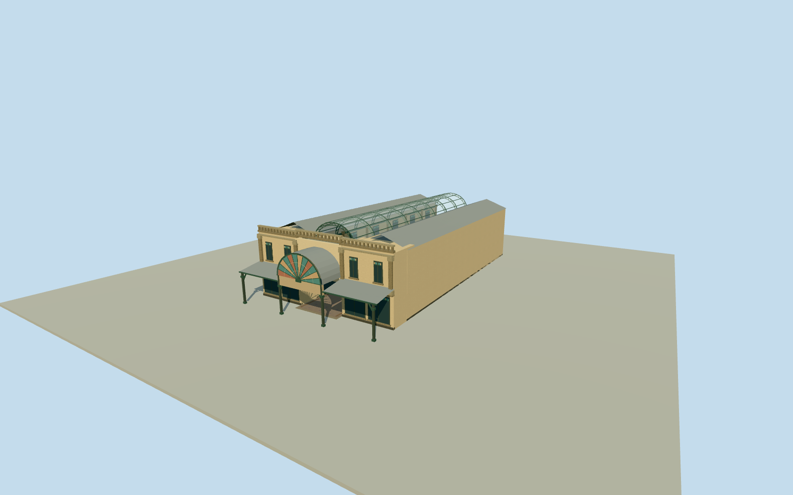

# Charters Towers Stock Exchange Arcade

Charters Towers’ Royal Arcade with twin veranda wings, colored semicircular fanlight, tall glazed interior barrel vault and heritage shop fronts.

Authoring state: **review-in-qa.json**. Current completion evidence is in [qa.json](qa.json) and the [completion ledger](../../../../qualla-structures/batches/qualla-003.PROGRESS.md).

- [Charters Towers Stock Exchange Arcade](https://qualla.com/charters-towers-stock-exchange-arcade/)

Wall, roof, interior passage and entry dimensions are estimates within the mapped footprint. The roof, street canopy, shop ranges and passage reflect primary descriptions. Painted colors and exact decorative patterns are interpreted from period construction.

The arcade passage and ground-floor glazing are represented. Individual offices, event displays and neighboring businesses are outside scope.

Build: `node content/worldgen/source/places/rk/rk2/charters_towers_stock_exchange_arcade/models/generate-stock-exchange-arcade.mjs`. Add `--check` to verify exact regeneration. 10878 triangles; 6 materials; no embedded photographs.
