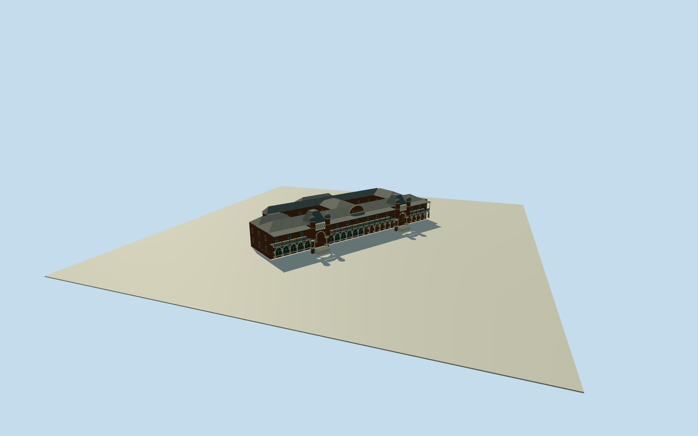

# Queen’s Hotel, Townsville (circa1932)

Complete circa1932 brick QueensHotel in Townsville: full long two-storey hotel body/side and rear accommodation/service ranges/closed roofs/two estimated open rear courts; pointed ground arcade and arched-window bays, deep upper covered veranda/iron rails/thin posts, two projecting arched entrances with four round turret shafts/cupolas and steep hipped mansard roofs, central curved parapet. Current retained fifteen-control outline provides approximate historical extent only; old hidden plan/rear/roof/sections and precise bay census explicitly estimated.

Authoring state: **review-in-qa.json**. Current completion evidence is in [qa.json](qa.json) and the [completion ledger](../../../../qualla-structures/batches/qualla-002.PROGRESS.md).

- [Queen's Hotel, Townsville](https://qualla.com/queen-s-hotel-townsville/)

ExactactualnamedQueensHotelway1024169001/15controls, nativeEnglishWikipedia49134105→Q24189521 identity, all1077every-statusreservationsclear. Currentretainedoutline onlyapproxhistoricalcontext, not complete1932survey or laterstudiobuildingtemplate; wholeoldhiddenrear/body/roofwillbe boundedestimates. LongnativeTheStrandstreetface NWcontrol4→SEcontrol5 establishesapproxfrontaxis inside immutableheading0/+Xeast/+Zsouth frame. Registration±10m/bearing±10degrees; no mainfloor/sections selected.

Fullphysicalcirca1932brickhotel, notfacade-only. Current15controlretainedbody/context differs afterlaterdemolition/restoration; originalhiddenrear/roof/sides/circulation/exactbays bounded estimates.

Photo1932far-rightendcropped/lefttreescoversomebays. Keepcompleteestimatedhotelbody andrepeatbaysratherthanonlyvisiblecrop; no modernstudio/earliertimber substitutions.

Original independentfield/frame beforeallfloors/mainparameters/geometry; neverflatten/reacquire/reframe orfitmainsections afterrenders.

NativeSLQexplicitexpiredrelease andarchiveitem proveunrecordedcreatorphotograph. Preserveunrecordedcredit; do not inventname, alterQuallamedia/rights or usequestionable/attribution-onlysupplements.

Source photograph has pointed ground arches and small round upper portal arcades. Initial research shorthand round groundarches corrected before main parameters/geometry. Full bay census/right crop/rear disposition estimated.

Main eave9.45m/ridge12.35m and floors+.5/4.85m, portal roof15.65m and turret15.05m are bounded visual estimates. No measured historical survey or exact current building claim.

Current retained15control exterior used as approximate complete site context with two open rear courts and service ranges as explicit hidden-plan estimates, retaining whole building rather than facade. Currentstudio alterations not adopted as1932facts.

Roof finish/color, simple timber windows/doors, ironrail pattern and plain silhouette cresting inferred. No sign lettering/people/cars/trees/flag/modernbroadcast equipment or decorative figures copied.

Build: `node content/worldgen/source/places/rk/rk8/queen_s_hotel_townsville/models/generate-house.mjs`. Add `--check` to verify exact regeneration. 53789 triangles; 6 materials; no embedded photographs.
