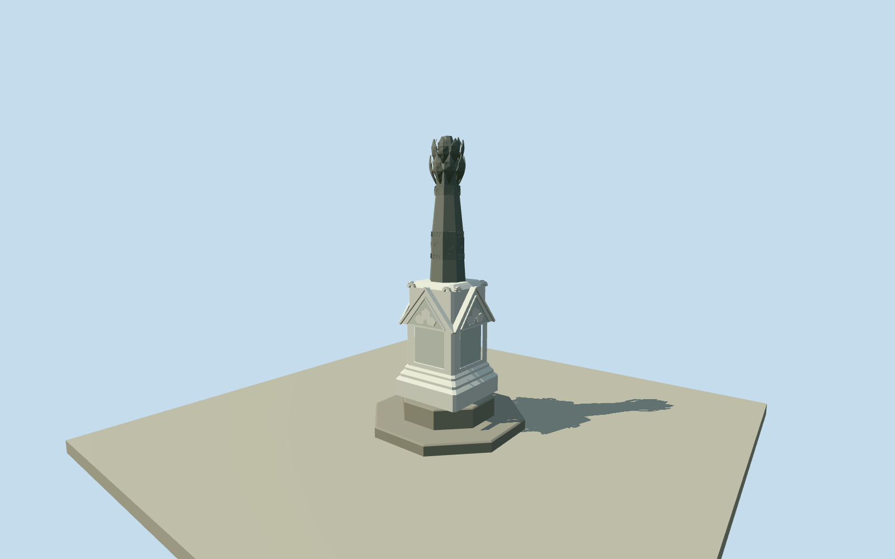

# Robert Towns Monument, Castle Hill

Complete Castle Hill Robert Towns Monument: two own octagonal stepped plinths, white chamfered Gothic tablet pedestal/four gables/trefoil relief/scroll shoulders, grey tapered octagonal shaft/medallion and toothed bands, and foliate broken capital. Exact named native point and actual southern access retained; all monument dimensions/facing photo-estimated. No natural hill or lookout grounds.

Authoring state: **review-in-qa.json**. Current completion evidence is in [qa.json](qa.json) and the [completion ledger](../../../../qualla-structures/batches/qualla-002.PROGRESS.md).

- [Castle Hill, Townsville](https://qualla.com/castle-hill-townsville/)

Exact original native monument node9963151475 fixes anchor[146.8033418,-19.2584779]. Native name/inscription/image match the published ROxBo detail original; its native file page reciprocally identifies the same OSM node. No monument footprint or QID is mapped. Real southern access way1111039400 connects Castle Hill Road to the pedestrian area containing the monument; original two nodes retained as contextual approach centreline, never a monument footprint. Signed+Z follows its outward direction heading0.4692196372683137rad. Plaque facing is a visual approximation to this access axis, not a surveyed facade bearing; uncertainty45degrees. All monument footprint/dimensions are photographic estimates. Fixed original path-end approach[-0.29438955256419685,8.412660127878084]before independent terrain and geometry.

Only this named monument within the original Castle Hill story; no castle/hill/site pad, parking, shelters, rails, vegetation, people or inscription text. Two own plinths retained as intrinsic structure.

Exact two published2008 ROxBo originals, native SHA1/own-photographer/PD-user-en matched and inspected. Other imagery unused; no supplemental photographs/copied pixels/generated bitmap.

No mapped monument footprint or verified vertical survey. Approximate6.8m height and all plinth/white pedestal/column profiles/ornament based on photo ratios. Hidden sides use bounded symmetric Gothic decoration; plaque orientation relative to actual native access axis is approximate by45degrees. Current finish after2008 and foliate census are estimates.

Independent32m129x129at0.25m terrain field frozen before geometry; provider260.4679m, full relative range[-4.4186,1.1222]. Original raw tile/grid/PNG unchanged without fitting, clipping or flattening. This oversamples4.51m output pixels and a coarser DEM; precise plinth foot, ground/threshold and host contact unverified. Geographic preview; replaceFootprint=false.

Build: `node packages/worldgen/scripts/generate-authored-places.mjs --ids=robert_towns_monument`. Add `--check` to verify exact regeneration. 4416 triangles; 4 materials; no embedded photographs.
