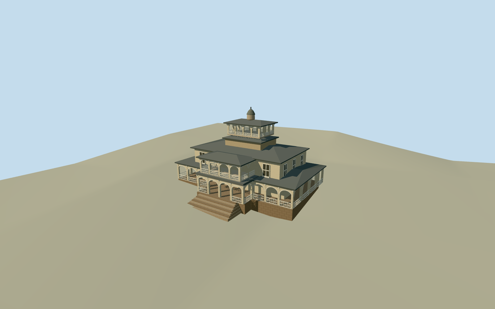

# Palace of King Bell

La Pagode, the Palace of King Bell in Douala, with repeated veranda arches, a central porch and a tiered cupola.

Authoring state: **review-in-qa.json**. Current completion evidence is in [qa.json](qa.json) and the [completion ledger](../../../../qualla-structures/batches/qualla-004.PROGRESS.md).

- [Palace of King Bell](https://qualla.com/palace-of-king-bell/)

Draft exterior: approximate photographic proportions and simplified ornament. It is not a survey, photogrammetric reconstruction or approved current geographic replacement.

The public-domain 1907 photograph gives the arched verandas, layered shallow roofs, wide stairs and top pavilion. A preservation account confirms the standing historic structure.

Terrain sampling/contact, geographic alignment and site activation remain pending. Runtime LODs are produced by the registered after-import pipeline and require visual review.

Reference photos remain in the local Qualla corpus; only provenance, paths and hashes are retained here.

Build: `node content/worldgen/source/places/s0/s0w/palace_of_king_bell/models/generate-palace-of-king-bell.mjs`. Add `--check` to verify exact regeneration. 13688 triangles; 6 materials; no embedded photographs.
