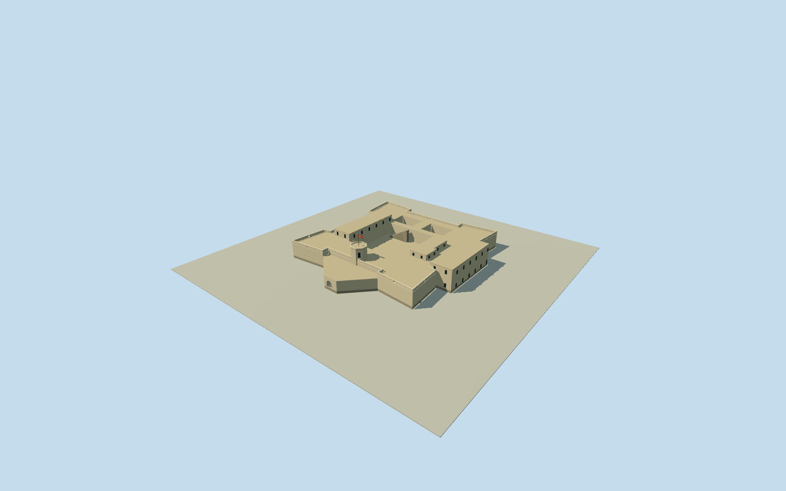

# Fort Prinzenstein — Keta,1847

Entirehistorical1847FortPrinzenstein/Prinsensten: allfourcornerbastions/fullcurtainterraces, wholeopencentralcourtyard andbothrearprisoncourts, allintrinsicwestern/easternupperrooms/eastattachedservicewing, wholeprojectingentranceoutwork/truearchedentry/octagonalwatchtower. Original1847commanderplan/exteriorininspected1918volume, namedcreator1893death. Fullplannotfacade/cannon/one-room/currentruinproxy. Absolutescale/sections/roof/height/grade/facingestimated; mainplannominal85.3x85.7m with25percentuncertainty. Entirelatererodedportionsincludedonlyasdated1847historicalform, no intactcurrentreplacement.

Authoring state: **review-in-qa.json**. Current completion evidence is in [qa.json](qa.json) and the [completion ledger](../../../../qualla-structures/batches/qualla-002.PROGRESS.md).

- [Fort Prinzenstein](https://qualla.com/fort-prinzenstein/)

Entirehistorical1847FortPrinzenstein/Prinsensten: allfourcornerbastions/fullcurtainterraces, wholeopencentralcourtyard andbothrearprisoncourts, allintrinsicwestern/easternupperrooms/eastattachedservicewing, wholeprojectingentranceoutwork/truearchedentry/octagonalwatchtower. Original1847commanderplan/exteriorininspected1918volume, namedcreator1893death. Fullplannotfacade/cannon/one-room/currentruinproxy. Absolutescale/sections/roof/height/grade/facingestimated; mainplannominal85.3x85.7m with25percentuncertainty. Entirelatererodedportionsincludedonlyasdated1847historicalform, no intactcurrentreplacement.

Selectedpublicdomain1847Svedstrupexteriorandgroundplan, inoriginal1918LarsenvolumePDF120/124printed121/125; titlepage4andcreditpage145inspected. NationalMuseumprimarytextconfirmscreator1819-1893/drawing1847; cachedtexttransmissionexplicit, directplaceholderunused. Modernlibrarywrapper/logo/allotherimagesunused. Quallafirst31familiesframedphotos/unrelatedinteriors/attribution-onlyexteriorsunused, no sourcequestions/rightsrepair.

Entire20controlmainfort/fourcornerbastions/wholecentralopencourtyard/bothrearprisoncourts, completewestern/easternupperrooms/attachedserviceannex/entranceoutwork/octagonalgatetower. Originalhanddrawnplanuniform0.132m/pixel, approximatewholemain85.3x85.7m. Original1788Isertpage33actuallyreadsKönigstein136x130ells; page105saysPrinsensteinlaidoutbysameauthorafterthatplanandsixfeetlarger. This1784templateisscalecontextonly, not certified1847metricplan. All1847absoluteplan andhistoricalpointregistrationuncertainty25percent/30m; compassbearingunverified, approximateheading0with45degreeuncertainty. No anisotropicplanstretch or nearbyhousefootprintproxy.

Afteroriginalframe/independent256mfield, floor0.35m/foundation-1.15m fixed. Mainterrace8.35m,1.55mparapet/top9.9m; westupperroomswall12.05m/roof12.4m,eastupperroomswall11.45m/roof11.8m,attachedannexwall11.85m/roof12.2m; flatroofprofiles/parapetsapproximatedfromoriginalperspective. Gateoutworkroof6.25m, octagonalwatchtowerfloor6.25m/wall15.05m/roof15.45m/parapet16.1m, radius4.62mfromdrawing; fullarchedentry1.8mhalfwidthepring2.7m/top4.5m. Exactheights/sections/roof/facing/gradeestimatedwithnominal3mheight/30mregistrationuncertainty. Allfrozenfield/floors/mainsectionsretainedthroughreview.

Fullcourtyardandtworearcourtsremainopentosky, truecontinuousarchedentrybarrelconnectsentranceoutworktomaincourtyard. Platformslits/threeopenarchedgunposts/eightroundedports positions/census andstairs/upperfenestration/cordons/cornersentinelhuts/flagmast/roofdetails explicitlyestimatedfrom1847drawing, no claimexact1847hardwareoroperatingstate. Actualoriginaldrawingrighthandannexroomfunctionuncertain, includedwholeasattachedservicewing. Detachedgardens/palmtrees/townbuildings/shorepaths/cannonsnotusedasfortproxy; roominteriors/furniturenotrepresented.

Limeplaster/stone/limeflat-roof/wood/shutter/glassfinishpalettesapproximatebecauseoriginal1918reproductionhaslimitedcolor. PrimaryICOMOSconstructiontextreportsstoneimportedAccraandshell-limemortar; no unsupportedstonequarryorspecificcolorclaim. OriginalproceduralsignlessarchitectureandbasicDanishcrossflaggeometry, no copiedmodernart/signage/textures.

Historical1847-08-03wholeintactfortonly, validuntil1848-01-01. SourceICOMOS2002reportsmorethanhalferodedby1993; currentruinnotreplacedbyintact1847model. Storypinabout1.2kmwrong, exactarticlelocation/content/curationpreserved; modelusesindependentlypublishedcorrectfortpoint/Q1438675/originalnamedPOI. Originalcurrentcoastalfieldnot1847ground; datum6.9372m/providerfield0.5463..14.6384m,currenturban/canopy/DEM/waterartifacts canburyorfloatlowergeometry. No cutout/mask/flatten/refetch/refit or cosmeticfloor/roofmovement. Ground/verticalregistrationunverified.

Build: `node content/worldgen/source/places/s1/s10/fort_prinzenstein/models/generate-house.mjs`. Add `--check` to verify exact regeneration. 6918 triangles; 6 materials; no embedded photographs.
