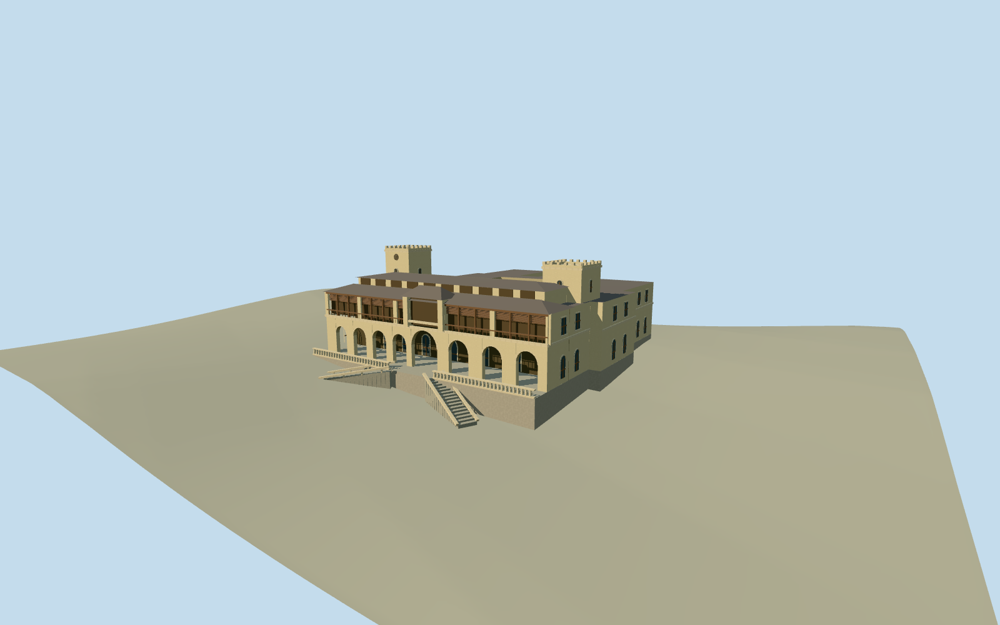

# Palais de Lomé

Togo’s former governor’s palace with twin unequal towers, cream arcades, teak galleries and terraced stairs overlooking the Atlantic.

Authoring state: **review-in-qa.json**. Current completion evidence is in [qa.json](qa.json) and the [completion ledger](../../../../qualla-structures/batches/qualla-004.PROGRESS.md).

- [Palace of the Governors, Togo](https://qualla.com/palace-of-the-governors-togo/)

An exterior reconstruction of the standing palace. Tower levels, small rear openings and the decorative metalwork are estimated from the available references. The garden, detached pavilions and interior galleries are outside the building model.

Build: `node content/worldgen/source/places/s1/s10/palace_of_the_governors_togo/models/generate-palace-of-the-governors-togo.mjs`. Add `--check` to verify exact regeneration. 11008 triangles; 6 materials; no embedded photographs.
