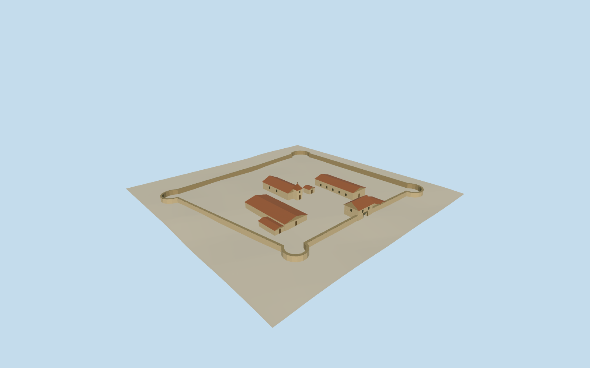

# Fort of São João Baptista de Ajudá

The low pale enclosure, entrance house, chapel and tile-roofed buildings of the former Portuguese compound in Ouidah around 1890.

Authoring state: **review-in-qa.json**. Current completion evidence is in [qa.json](qa.json) and the [completion ledger](../../../../qualla-structures/batches/qualla-003.PROGRESS.md).

- [Fort of Sao Joao Baptista de Ajuda](https://qualla.com/fort-of-sao-joao-baptista-de-ajuda/)

Circa 1890 reconstruction from the two dated archival records. Museum-era buildings and grounds are outside this time slice.

The historic gate orientation and the fit of the archive plan inside the mapped enclosure are approximate. Roof and wall heights and finishes are estimated from the drawings.

Original terrain elevations are retained. Individual historic foundation heights and any lost landscaping are approximate.

Build: `node content/worldgen/source/places/s1/s11/fort_of_sao_joao_baptista_de_ajuda/models/generate-fort.mjs`. Add `--check` to verify exact regeneration. 778 triangles; 5 materials; no embedded photographs.
