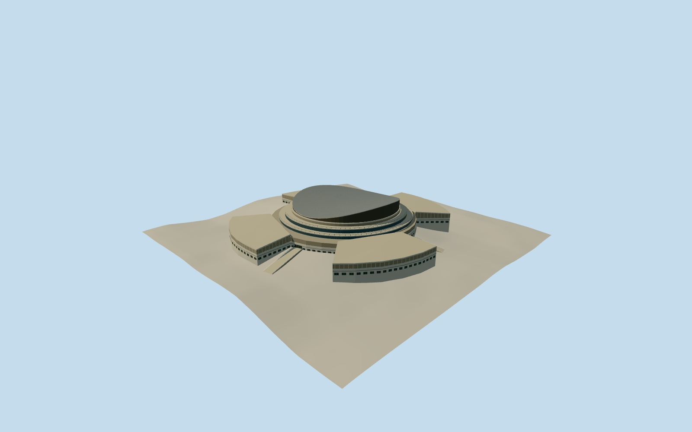

# National Arts Theatre, Lagos

National Arts Theatre in Lagos in April 1978, with its four curved wings, ring terraces and saddle auditorium roof.

Authoring state: **review-in-qa.json**. Current completion evidence is in [qa.json](qa.json) and the [completion ledger](../../../../qualla-structures/batches/qualla-003.PROGRESS.md).

- [National Theatre, Nigeria](https://qualla.com/national-theatre-nigeria/)

The original modern mapped building footprint and its four radial sectors establish the structure. The section is reconstructed from the documented 31-meter height, four ramped entrances, three roof-terrace rings, two glazed tiers and a saddle shell. The 1978 façade proportions, roof curvature and finishes are visual estimates.

The provider heightfield is preserved and includes probable influence from roofs or vegetation. It does not establish the 1978 forecourt survey grade. Foundations and ramps use approximate registration. The individual approach positions, thresholds and ramp lengths estimate grade from samples around the mapped footprint.

The model depicts the April 1978 exterior. Later station and renovated campus features, interiors and adjacent grounds are outside scope.

Build: `node content/worldgen/source/places/s1/s14/national_theatre_nigeria/models/generate-theatre.mjs`. Add `--check` to verify exact regeneration. 8291 triangles; 5 materials; no embedded photographs.
