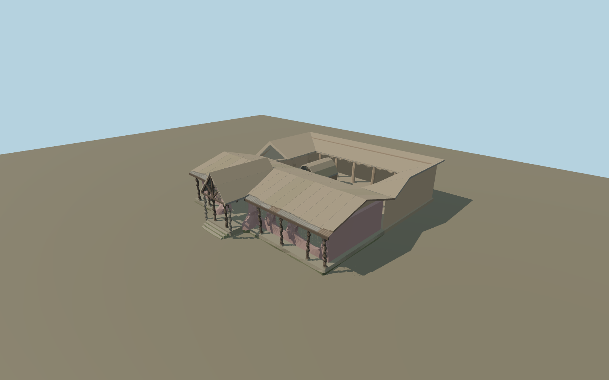

# Ojúbọ Òṣogbo, First Palace

The First Palace is the central Ọ̀ṣun shrine in the Ọ̀ṣun–Òṣogbo Sacred Grove. The model includes the projecting timber gable and carved porch posts, recessed openings and a weathered stone foot. The roof wraps around an open court with three galleries and a small curved canopy. Both entrance wings expose corrugated metal beneath uneven straw. Street and close-up views show the ribs and tapered straw ends. [First Palace photo exhibit](https://artsandculture.google.com/story/BgURvVEBTRI0TA) · [Aerial footage](https://www.youtube.com/watch?v=DFvp6TAVAKw)

The overall roof arrangement follows the aerial footage. The street and close-up models place asymmetric stripes, arcs and dotted fields on the plaster behind the porch openings. The courtyard canopy has two differently carved supports and a smaller figure beside the right post. The exact motifs, gallery dimensions, sculpted forms and court grade are interpreted. Five shared materials supply wood, plaster, sandstone, thatch and painted metal. [CyArk courtyard view](https://www.youtube.com/watch?v=Ih0Y4OjkxdM) · [Courtyard preview](courtyard-preview.webp) · [QA record](qa.json)

The 2024 entrance photos show faded rose plaster, a recessed iron grille and long, uneven fibers below the right eave. Narrow scroll panels frame the grille. The iron uses the shared painted metal material, and the fibers reuse thatch. The flared jambs and rounded steps follow the shrine trust photographs. Grille spacing, plaster tint, fiber lengths and jamb dimensions are estimates. [2024 entrance photograph](https://commons.wikimedia.org/wiki/File:Entrance_To_The_First_Palace_in_Osogbo.jpg) · [Shrine Trust photographs](https://artsandculture.google.com/story/BgURvVEBTRI0TA)

Worn sandstone paving surrounds the carved canopy supports at street and close-up detail. The gable behind the posts covers a recessed doorway and a low stone threshold. Tapered thatch hangs along the front edge. The doorway dimensions, slab shapes and courtyard grade are estimated. The footage shows the threshold and the near recess. [Courtyard footage](https://www.youtube.com/watch?v=Ih0Y4OjkxdM) · [Courtyard preview](courtyard-preview.webp)

Run `node content/worldgen/source/places/s1/s17/osun_grove_first_palace/models/generate-first-palace.mjs` to rebuild the source master. Add `--check` to compare exact bytes. Use `--ids=osun_grove_first_palace` for targeted import and detail-level generation.

The world viewer uses the geotagged entrance fit, with the façade facing about 265° true. Alternate photo controls give bearings of roughly 252°–268°. A bounded terrain grade supports the court and keeps the lowest step about 6 cm above the approach in all four detail levels. The model clears the mapped road and river. Its exact footprint and grade are approximate. [Entrance photograph](https://commons.wikimedia.org/wiki/File:Entrance_To_The_First_Palace_in_Osogbo.jpg) · [Placement review](placement-report.json)
