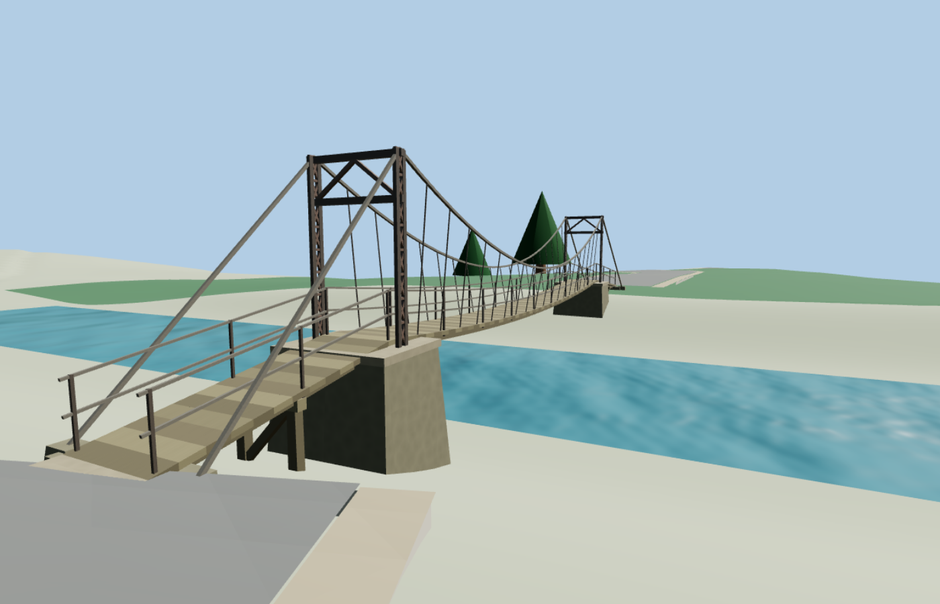

# Osun Grove suspension footbridge

The model reproduces the two portal towers, timber approaches and 31.64 m suspended crossing. The cables connect into their bank anchor blocks. All tiers preserve the open portal, sagging main cables and cambered deck.

The signed bearing comes from the mapped footbridge line and the geotagged festival image fixes its northwest approach. The fitted landings are within 1 mm of the rendered approaches at the sampled points. The native render shows at least 2.38 m between the water and the top of the deck at the sampled crossings. The deck remains above the untreated terrain at the sampled points. Loading removes only the two mapped fragments of the procedural bridge and preserves independent road and river lines.

| Detail level | Triangles | Download bytes | Draws |
| --- | ---: | ---: | ---: |
| skyline | 984 | 78,276 | 3 |
| district | 2,784 | 212,356 | 3 |
| street | 4,468 | 341,548 | 3 |
| closeup | 5,752 | 440,408 | 3 |

The first two tiers total 290,632 bytes. Six GLBs validate with zero errors or warnings. The scene validates and runs for 30 ticks. All 260 placement probes passed, and 64 images were inspected.

The signed alignment and 31.64 m crossing endpoints come from PMTiles. The deck width, pier stations, rail spacing, cable sag and individual timber dimensions are exterior photo estimates.

The grove forest and River Osun remain native map features. Only the suspension crossing is represented by this asset. The grove palaces, shrines, gates and monuments need their own source models and reviews.

The standard Terrarium surface is nearly flat through the mapped river. The reference presentation uses a tightly bounded visualization grade in the channel. Water width and piers are approximate.

[Bridge photograph](https://commons.wikimedia.org/wiki/File:The_Osun_Osogbo_sacred_grove_03.jpg) · [Landing photograph](https://commons.wikimedia.org/wiki/File:A_crowd_attending_the_Osun_Osogbo_Annual_festival.jpg) · [QA evidence](qa.json)
