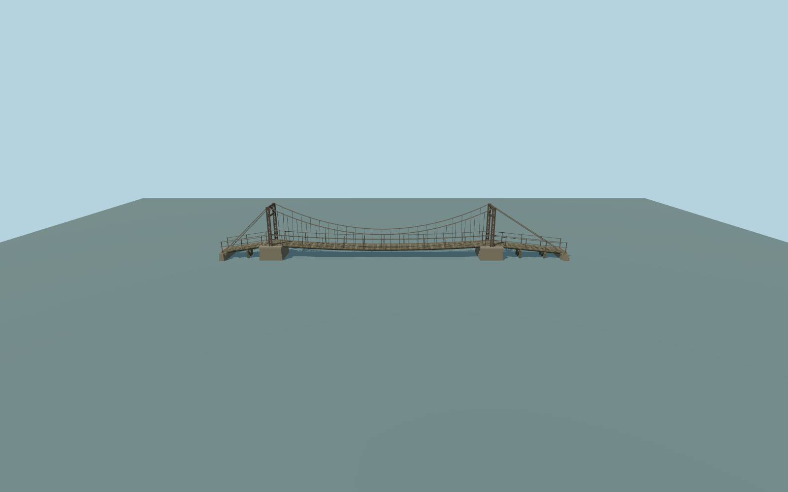

# Osun Grove suspension footbridge

Narrow timber suspension crossing with two rust-brown open steel portal towers on rectangular concrete piers, paired sagging cables and hangers, wire guard rails and trestle approaches on the banks of River Osun.

Run `node packages/worldgen/scripts/generate-osun-grove-suspension-bridge.mjs` to rebuild the source master. Append `--check` to compare the exact bytes. Use `--ids=osun_grove_suspension_bridge` for targeted import, LOD generation and placement.

The signed alignment and 31.64 m crossing endpoints come from PMTiles. The deck width, pier stations, rail spacing, cable sag and individual timber dimensions are exterior photo estimates.

The grove forest and River Osun remain native map features. Only the suspension crossing is represented by this asset. The grove palaces, shrines, gates and monuments need their own source models and reviews.

The standard Terrarium surface is nearly flat through the mapped river. The reference presentation uses a tightly bounded visualization grade in the channel. Water width and piers are approximate.

Original geometry uses the repository license. Map data:© OpenStreetMap contributors,ODbL-1.0;Protomaps. Standard terrain:terrain-grid.json. Ordinary pictures stay local and are not redistributed or used as textures. Current acceptance:qa.json.
