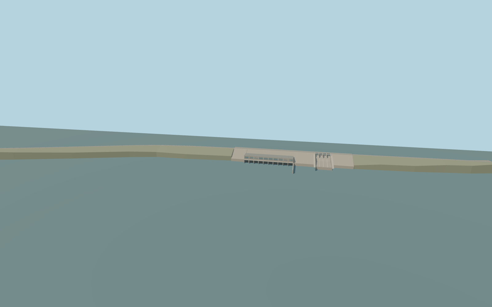

# Kainji Dam

Kainji Dam’s mapped rock-fill embankments, four radial spillway bays, generating hall and tailrace, and the two navigation locks on the bypass canal.

Rebuild: `node packages/worldgen/scripts/generate-kainji-dam.mjs`;append `--check` for exact source bytes. Select import/LOD/placement with `--ids=kainji_dam`. Detailed source and four browser tiers are separate ignored GLB outputs.

Standard Terrarium sets the reservoir at 139.00 m and the near-tailwater review plane at 108.42 m. The production sampler returns 139.51–139.65 m upstream and 103.15–109.05 m downstream across the retained windows.

The site-specific model covers the 3.44 km mapped embankment, four radial gates, the main power hall and both navigation chambers. The separate road bridges and surrounding buildings remain native.

The standard terrain and mapped canal establish plan and local grade. Lock leaf sizes, machinery, exact gate opening heights and the staged water surfaces are visual interpretations.

The local downstream water sampler varies by branch and window. The review planes show an illustrative lock cycle and do not drive native world water levels.

Original geometry:repository license. Map:© OpenStreetMap contributors,ODbL-1.0;Protomaps. Standard terrain:terrain-grid.json. Ordinary pictures stay local and are not redistributed or used as textures. Current acceptance:qa.json.
