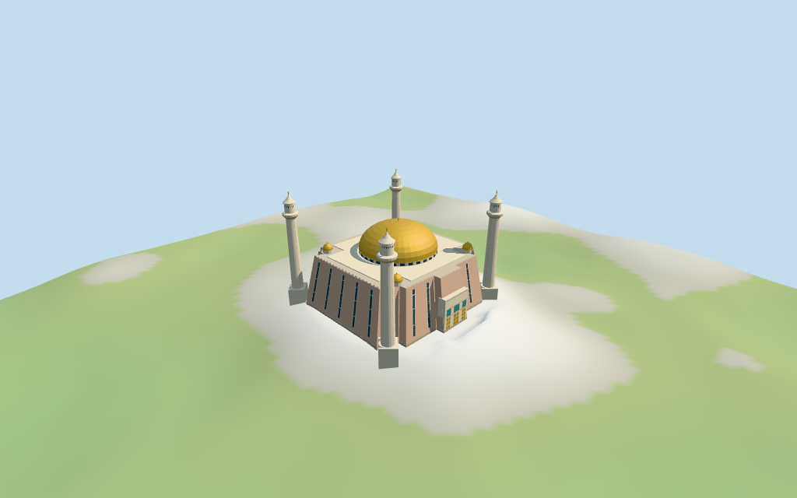

# abuja_national_mosque — Abuja National Mosque

Reviewed 2026-10-18 for its declared medium-fi exterior and approximate geographic fit. Current named PMTiles geometry establishes the site;heights retain map tags with an unspecified datum and architectural subdivisions remain estimates.

## Exterior and shared materials

Inspected all 11 current portable views, including the retained1024×640 summary. The mapped stepped square envelope has warm inward-battered walls,narrow dark fields,a pale roof and cusped parapet,broad gold central dome with a dark drum band,four smaller gold cupolas,and four slender pale minarets with flared collars and pointed caps. The west entrance has brass door fields and original coarse blue-green panels. The dome spring and detail cameras were revised after first inspection. The review fixture ground datum now matches the negative local floor. Doors and recesses are opaque exterior abstractions;there is no claimed navigable interior. Fine historic calligraphy,mosaic art,site walls,landscaping and engineering are omitted.

Inspected 11 current shared-material/geographic views,including the placement overlay and complete entrance at the corrected review ground datum. Six existing256² graphs supply raw sandstone,raw/weathered limestone,membrane,bronze and ceramic;seven merged roles include local opaque glazing. Metric UVs and linear tints;no embedded images or unique atlas. Shared graphs are read once and eviction disposes model geometry. The outer replacement hull encloses the named main hall and separate corner bases;five occupied ground masks avoid removing the whole grounds. All10 independent nearby building records remain unchanged. Flat placement views establish approximate pose and subtraction,not measured terrain contact.

## Browser levels

| Level | Triangles | Bytes | Draws |
| --- | ---: | ---: | ---: |
| skyline | 704 | 75608 | 1 |
| district | 1313 | 139904 | 7 |
| street | 3066 | 315748 | 7 |
| closeup | 4426 | 461252 | 7 |

**215,512 bytes for initial skyline plus district**, plus six existing shared 256² graphs. Seven merged roles; no embedded images.

Inspected27 current medium-fi views:Economy/High,noon/late light,street/block/skyline,silhouette,six details,four matched LODs and four transitions. All levels retain the broad gold dome,the battered stepped mass and four pointed minarets. Skyline deliberately drops facade recesses and parapets and has faceted roof/caps;district adds the dark vertical rhythm,roof band and simple entry panels;street/closeup add sparse grids,door divisions,cusps,ribs and more curved roof/cap forms. Whole cameras keep the complete towers;detail views intentionally crop other sections. Terrain and procedural neighbors are illustrative. Physical laptop/phone/tablet and full-city timing remain unmeasured.

## Placement and limits

Retained Q1430127 had only reference point[7.4925,9.060833333],no physical footprint and no dimensions. Current ordinary PMTiles supplies two Abuja National Mosque POIs;one shares the24-vertex main building id35184560926061. That named footprint and ten associated roof/minaret parts establish the current physical site,about305 m west of the old reference. The current named point fixes the model anchor;the old reference is retained verbatim. Cardinal axes and the west entrance are approximate visualization choices from map shape and inspected pictures. Standard Protomaps20261014/Mapzen-USGS viewer extractN0485;datum 498.1265962123871 m. 1244 occupied samples range -14.247668434609295 to 0.9322398987239922 m;floor -7.606917910409891 m is the median of 157 occupied-edge samples plus0.25 m. Five masks seat only the main hall and four corner bases,with an8 m fixture margin. No whole-site landscaping,roads,terraces or finished grades are surveyed. Independently reproduced11 current map controls and115 vertices,two named points,all raw tags and retained empty dimensional facts. The named point sharing the main building id anchors this model;the legacy reference point remains in the source. Mapped roof/upper part and base/column heights are retained. All126 placement/host-area checks and1058 FrontSide probes pass for opaque recesses,doors/panels,visible gold roof shells/finials,upper drum screens,minaret shafts/caps/tips and all five base foundations. Standard DEM reproduces1244 occupied samples,157 edge samples,627 seated fixture points and the16-bit heightmap. Finished grades and the host terrain datum remain approximate;deep footing faces are not surveyed retaining walls.

Individual Abuja National Mosque exterior: mapped stepped square envelope with inward-battered warm stone facades,narrow dark recesses,an upper cross-shaped mass,broad golden central dome and small roof cupolas,four slender cream minarets with flared collars and pointed caps,a recessed-looking west entrance with brass doors and original coarse colored panels,and a low cusped parapet. The separate grounds buildings,boundary walls,landscaping,street,interiors,historic artwork,inscriptions and engineering are excluded. Current upper part retains min_height25/height30 m;roof retains min_height30/height40 m;four tower bases retain height6 m;two column parts retain height55 m and two have no height. The source uses the upper part25–30 m as a roof-zone envelope,roof top40 m and overall tower tips55 m above the local floor;the other two tower tips infer the same55 m. Lower hall top25 m,body batter,small cupolas,roof finial42 m,shaft/balcony/cap subdivisions and parapets are visual estimates. Map height datums are unspecified. The mapped roof min_height30 m is retained as a tag but is not treated as a surveyed spring:the pictured dome is reconstructed from an estimated27 m spring to its mapped40 m top. The upper drum/terrace subdivisions are estimates within the mapped roof-zone envelope. The current named footprint and associated parts support approximate visualization. The2019 distant exterior,2014 entrance detail and2005 full exterior guide the characteristic colors and forms;they do not establish present condition. Facing,body batter,roof spring,small cupolas,facade rhythm,door/portal proportions,minaret stage transitions and grounds remain estimates. No invented exact measurements,inscriptions or copied photo textures are claimed. Interiors,engineering,surveyed grades and complete current condition remain unverified or omitted.

## Verification

49 current views inspected; 1058 FrontSide probes; 126 placement/host-area checks; six zero-error/zero-warning Khronos validations. Model/source/input/material/capture/placement hashes agree. Raw map compound/part controls and 16-bit terrain fixture reproduce. Source/placement checks, scene validate/sim30, selected LOD layout and Biome pass. Bulk captures stay ignored.

Source: sha256:acec79152a9bac13d03c713b87e1f3cc15873ec4ffa857ad8d6ac4732a40637c

Runtime: sha256:501937cb501d0740fea9b584b710a8c144eb2530b7dea2a90d5cebbbf3b75fec

Input: sha256:df71b4ea7edef699869a152f1ebc233e335bde46a19d2e75bd2515961118259d

Commands: targeted generate-additional-landmarks/import-structure-models/generate-landmark-lods/register-landmark-previews --ids=abuja_national_mosque; source/placement --check; capture-structure-models --reflections --antialias --fit-shadows; capture-landmark-library --reflections --adaptive-clipping --bounded-placement; capture-medium-fi --ids=abuja_national_mosque --reflections; scene validate/sim30; selected LOD layout; Biome. Existing builds reused.

## Inspected picture references

[Anass Sedrati — 2019-11-08](https://commons.wikimedia.org/wiki/File:National_Mosque_-_Abuja.jpg). CC-BY-SA-4.0. Inspected960×720 distant street view. Broad gold dome,four pale slender minarets and low warm-stone mass are visible. Trees,distance and construction foreground obscure facade detail;the communications mast is not part of the mosque.

[Mark Fischer — 2014-02-08](https://commons.wikimedia.org/wiki/File:Main_entrance_to_the_Abuja_National_Mosque.jpg). CC-BY-SA-2.0. Inspected960×638 entrance detail:three brass door groups in a pale warm-stone recess,coarse gold frames and blue-green tile fields. Original simplified color panels and door subdivisions only;no historic calligraphy or exact mosaic artwork is copied. This is not a complete elevation.

[Shiraz Chakera — 2005-09-16](https://commons.wikimedia.org/wiki/File:AbujaNationalMosque.jpg). CC-BY-SA-2.0. Inspected960×718 full exterior. Gold central dome above a banded/windowed support,small golden cupolas,warm inward-battered facades with narrow vertical dark recesses,cusped parapet,and four pale minarets with flared collars and pointed bell-like caps. Third picture was needed because the first is distant and the second only entrance detail. Older condition is not a current measured elevation.
