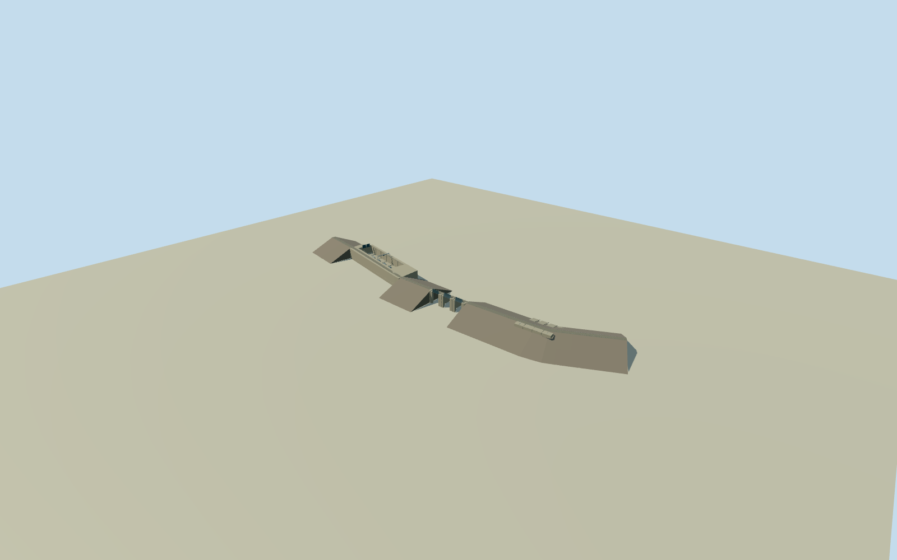

# Bujagali Dam and Powerhouse — Victoria Nile

Whole physical Bujagali dam and integral open-air powerhouse/intake: complete original49control main dam boundary, full connected11control/~899m crest route, five-unit169x39m named plant envelope, main gated spillway/weir and emergency siphon spillway. Primary construction designers/engineer/contractor describe30m clay-core rockfill and concrete gravity sections, three rockfill sections, two radial/one flap main gates, emergency spillway, five Kaplan units, integral intake and explicitly open-air powerhouse inside dam body. No generic roofed industrial shed or bare embankment proxy. Exact native outer body/route and narrow plant envelope retained; the latter is taggedpower=plant, not a surveyed architectural footprint, so its precise role/internal divisions and all floor/vertical/slope/bay/finish/grade details are explicitly estimated. Whole intrinsic dam/intake/powerhouse/spillways included. Detached substation, transmission lines, wider industrial site/buildings, river/reservoir, former falls and interiors excluded as separate objects. No imagery used or photographic fidelity claimed.

Authoring state: **review-in-qa.json**. Current completion evidence is in [qa.json](qa.json) and the [completion ledger](../../../../qualla-structures/batches/qualla-002.PROGRESS.md).

- [Bujagali Hydroelectric Power Station](https://qualla.com/bujagali-hydroelectric-power-station/)

Whole physical Bujagali dam and integral open-air powerhouse/intake: complete original49control main dam boundary, full connected11control/~899m crest route, five-unit169x39m named plant envelope, main gated spillway/weir and emergency siphon spillway. Primary construction designers/engineer/contractor describe30m clay-core rockfill and concrete gravity sections, three rockfill sections, two radial/one flap main gates, emergency spillway, five Kaplan units, integral intake and explicitly open-air powerhouse inside dam body. No generic roofed industrial shed or bare embankment proxy. Exact native outer body/route and narrow plant envelope retained; the latter is taggedpower=plant, not a surveyed architectural footprint, so its precise role/internal divisions and all floor/vertical/slope/bay/finish/grade details are explicitly estimated. Whole intrinsic dam/intake/powerhouse/spillways included. Detached substation, transmission lines, wider industrial site/buildings, river/reservoir, former falls and interiors excluded as separate objects. No imagery used or photographic fidelity claimed.

Primary construction-designer text explicitly identifies an open-air powerhouse inside the dam body, five Kaplan units,30m clay-core rockfill dam and approximately560m earthfill crest. Engineer confirms30m concrete/rockfill, main spillway with two radial/oneflap gate, emergency spillway and about22m gross head. Builder reports overall900m dam, three clay-core rockfill sections and siphon spillway. Native full crest measures about899m; original paths are not stretched to the rounded project length.

All49native dam-body boundary controls,11connected crest controls, four narrow169x39m plant controls and twoweir controls fixed as original plan evidence. The native waterway=dam polygon does not certify a surveyed toe or crown edge; its edge role remains uncertain. The model uses exact crest route and whole mapped plant as the main horizontal controls, with estimated three earthfill functional intervals,10m crown,2.2H:1V side slopes, gravity-block edge interpretation and gate/emergency partitions. Native body ring is retained for plan/context, not falsely certified as a measured30m-deep toe footprint.

CrestY7.55m above original1107.9509m provider anchor is an explicit elevation estimate, not a surveyed absolute1115.5m level. Nominal30m dam height and22m gross-head proxy place an estimated lower working floor. Powerhouse floor, submerged foundation, wall/rail/crane heights, five open unit bays, turbine/closure covers, intake partitions, two stored wheel gates, main3gate sections,80m emergency-siphon housing/fourcells and all detailed finish are estimates. No source engineering drawing traced; designer L19m spillway statement is not treated as a certified individual opening width.

Full combined physical dam/intake/open-air powerhouse and both spillways retained. Three rockfill sections run along the exact original crest; native plan functional cut positions are estimates. Open-air powerhouse has complete unit trench/basement exterior, integral intake, service zone and a supported crane/gantry; no invented enclosing shed roof. Scientific/internal turbine operation, detached substation/switchyard/transmission lines/buildings and surrounding river/reservoir/former falls excluded as separate objects.

Original independent2048m/16641height source field and nine raw tiles frozen before all floor/main sections. Original source includes a severe low river/DEM artifact near495.56m against the1107.95m anchor and coarse crest/plant offsets. The field is preserved with no mask/flatten/cutout/reacquisition or visual refit. Terrain can obscure parts of lower works; provider grade/vertical registration unverified. Approximate dated2019placement only, no surveyed ground contact or automatic current-world replacement.

All photographs/figures/drawings unused. Qualla-first clear PDpre-dam falls/CC0rafting sources do not show the plant. Direct primary construction text facts used; no imagery license, photographic fidelity or precise2019configuration/2026condition certification claimed.

Gates use an estimated raised static equipment pose so the full panel/hoist forms are readable; no operating state or hydrological flow is certified. Original upstream and downstream chute floor heights and all frozen dam/foundation/crest/powerhouse parameters remain unchanged. Closed crest deck and local support piers are structural details. Emergency outlet alignment is estimated, including a buried conduit segment through the embankment.

Build: `node content/worldgen/source/places/s8/s8p/bujagali_hydroelectric_power_station/models/generate-house.mjs`. Add `--check` to verify exact regeneration. 5538 triangles; 5 materials; no embedded photographs.
