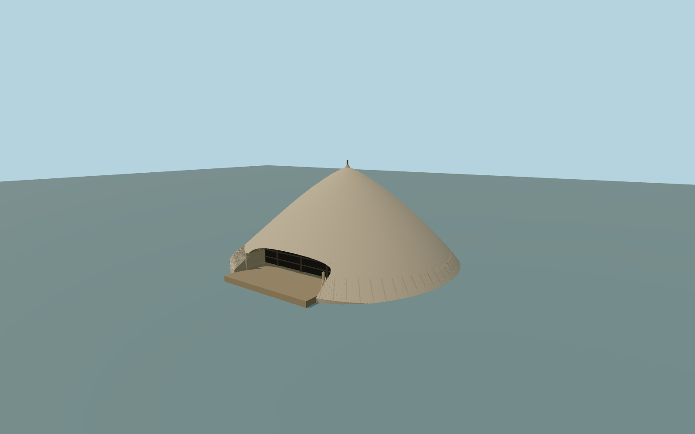

# Kasubi Tombs / Muzibu Azaala Mpanga

The unique principal Muzibu Azaala Mpanga royal tomb exterior:complete broad curved thatched shell with naturally hanging near-soil hem,plain small apex cap/finial,a wide low arched entrance cut into the roof with actual recessed depth,closed dark reed/timber backing,closed ceiling/jamb reveals and earthen entry floor. Sparse original reed/timber framing and geometric lower thatch bundles. Independent gate,drum-house,court,royal-family houses and30-hectare estate remain native;no generic substitute model,no navigable interior or graves.

Rebuild: `node packages/worldgen/scripts/generate-kasubi-tombs.mjs`;append `--check` for exact source bytes. Select import/LOD/placement with `--ids=kasubi_tombs`. Detailed source and four browser tiers are separate ignored GLB outputs.

The unique principal Muzibu Azaala Mpanga royal tomb exterior:complete broad curved thatched shell with naturally hanging near-soil hem,plain small apex cap/finial,a wide low arched entrance cut into the roof with actual recessed depth,closed dark reed/timber backing,closed ceiling/jamb reveals and earthen entry floor. Sparse original reed/timber framing and geometric lower thatch bundles. Independent gate,drum-house,court,royal-family houses and30-hectare estate remain native;no generic substitute model,no navigable interior or graves.

PMTiles principal footprint is29.86 by30.16m,area681.4m2,no height tags or inner hole. Circular roof diameter30.3m,crown12.1m,plain finial12.98m,12m wide entrance rising2.95m above a0.6m entry floor andback plane9.2m are ordinary-picture proportions,not surveyed dimensions. Datum1238m is rounded current standard field elevation;natural outer hanging hem follows that unchanged field plus0.18m. Entry level is an approximate reasonable visualization threshold,not a historic survey.

Two ordinary exterior pictures:2025 UNESCO confirms reconstructed thatch while an older full-front picture supplies the complete roof/mouth form. Hidden framing,precise straw pattern,current restored fittings,original support rhythm andfinial are medium-fi approximations. Photographs are not redistributed or used as textures. Exact thresholds,interiors/royal graves,numerical LOD errors andphysical-device timings are outside this acceptance. Circular shell versus decagonal native outline is an explicit map approximation.

Four existing shared256px thatch,bamboo,wood andrammed-earth graphs,four groups maximum,metric UVs/linear colors andno private orembedded images. Alltiers preserve thecomplete closed shell,deep wide arched mouth,closed backing/reveals,entry floor andplain apex. Detailed source retains finer curves andfringe.

Original geometry:repository license. Map:© OpenStreetMap contributors,ODbL-1.0;Protomaps. Standard terrain:terrain-grid.json. Ordinary pictures stay local and are not redistributed or used as textures. Current acceptance:qa.json.
