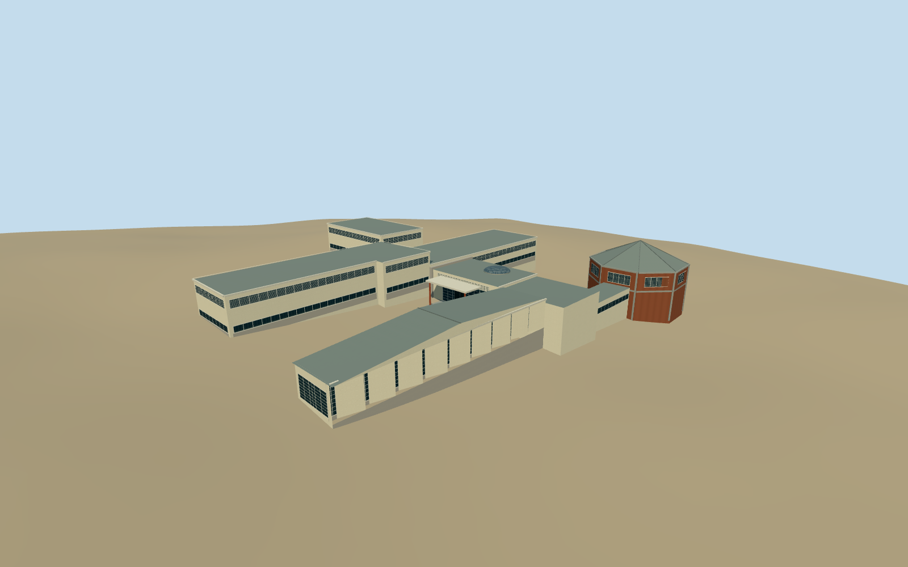

# Uganda Museum

1954 Uganda National Museum and linked galleries on Kitante Hill. Includes the thin porch on columns, concrete screens, pale skylight, saw-leaf gallery, and the later octagonal Natural History Gallery.

Authoring state: **review-in-qa.json**. Current completion evidence is in [qa.json](qa.json) and the [completion ledger](../../../../qualla-structures/batches/qualla-003.PROGRESS.md).

- [Uganda Museum](https://qualla.com/uganda-museum/)

The standing profile represents the historic building documented by the conservation survey before the announced renovation. Final renovation alterations and the cultural village are outside the model.

The concrete louvres, window spacing, shade of exterior finishes, saw-leaf sections, roof junctions and additions are architectural estimates. The original survey’s photos and drawings were excluded.

Build: `node content/worldgen/source/places/s8/s8p/uganda_museum/models/generate-uganda-museum.mjs`. Add `--check` to verify exact regeneration. 3091 triangles; 7 materials; no embedded photographs.
