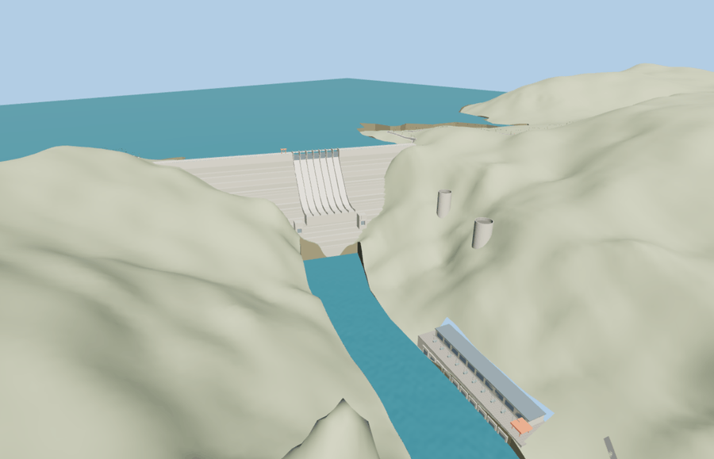

# Gilgel Gibe III Dam

The stepped RCC gravity wall carries seven continuous ski-jump chutes, two lower outlet portals, the crest crane, and open surge shafts. The generator hall follows the downstream right bank with ten modeled outfalls. The source and close-up have separate terrace and shaft detail.

The Earth viewer renders the upstream reservoir at 889 m and the downstream Omo plunge pool and tailrace at 698.46 m. The local shoreline follows the retained river centerline and the photograph around the powerhouse and tapers back to the mapped river. The seven dry spillway chutes, lower outlets and two surge shafts remain visible. The separate bridge and all 17 mapped road records are retained.

The Earth fixture retains all three mapped service road records. The ground opening follows the upper central arch. Failed loading preserves the native layers. Eviction restores the ground and releases model geometry.

| Detail level | Triangles | Download bytes | Draws |
| --- | ---: | ---: | ---: |
| skyline | 994 | 79,068 | 7 |
| district | 1,742 | 125,892 | 7 |
| street | 3,852 | 285,092 | 7 |
| closeup | 4,852 | 359,424 | 7 |

Skyline and district total 204,960 bytes. Six GLBs pass Khronos validation and contain zero embedded images. Six shared material graphs bind in the viewer. The review covers 68 renders and 160 geographic samples.

The downstream bank widths, static water stages and river bed grade are representative. The source terrain leaves angular edges around the gorge and only approximates the apron tie-in. Shafts, outfall details and buried foundations are based on exterior photographs.

This model depicts the static exterior. Operating discharge and underground equipment are outside its scope.

[Mapped site frame](map-frame.json) · [Terrain and water fit](site-fit.json) · [QA evidence](qa.json)
