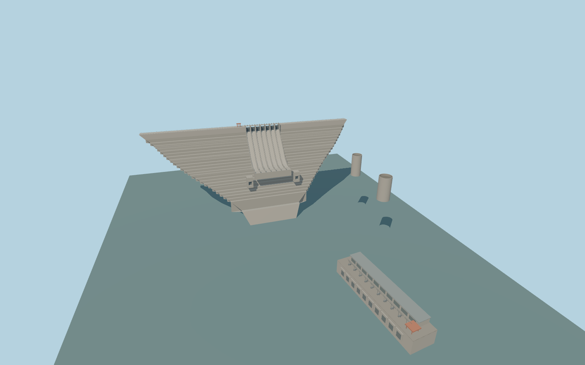

# Gilgel Gibe III Dam

Gilgel Gibe III stepped gravity dam with a 630 m crest, seven curved radial-gate chutes, two lower outlets, a red crest crane, riverside generator hall, ten outfalls and two surge shafts.

Rebuild: `node packages/worldgen/scripts/generate-gilgel-gibe-iii-dam.mjs`;append `--check` for exact source bytes. Select import/LOD/placement with `--ids=gilgel_gibe_iii_dam`. Detailed source and four browser tiers are separate ignored GLB outputs.

Fixed 707.5954505 m model datum and 896 m modeled crest. Reference operating pool is 889 m. Standard terrain sampling gives 704.09 m upstream and 698.46 m downstream. The older elevation drawing and contractor’s completed exterior dimensions have different wall height conventions.

The standard terrain places headwater approximately 184.91 m below documented normal pool. The model is a preview pending native reservoir fit.

The downstream water footprint is a review approximation from the mapped Omo centerline and photographs. The riverbanks and approaches retain the standard viewer terrain.

The visible main hall and ten outfalls align with the PMTiles features. Shaft placement and heights, buried foundation, bank terraces and operating equipment are approximated. Power tunnels, switchyard and operating discharge are outside the static model.

Original geometry:repository license. Map:© OpenStreetMap contributors,ODbL-1.0;Protomaps. Standard terrain:terrain-grid.json. Ordinary pictures stay local and are not redistributed or used as textures. Current acceptance:qa.json.
