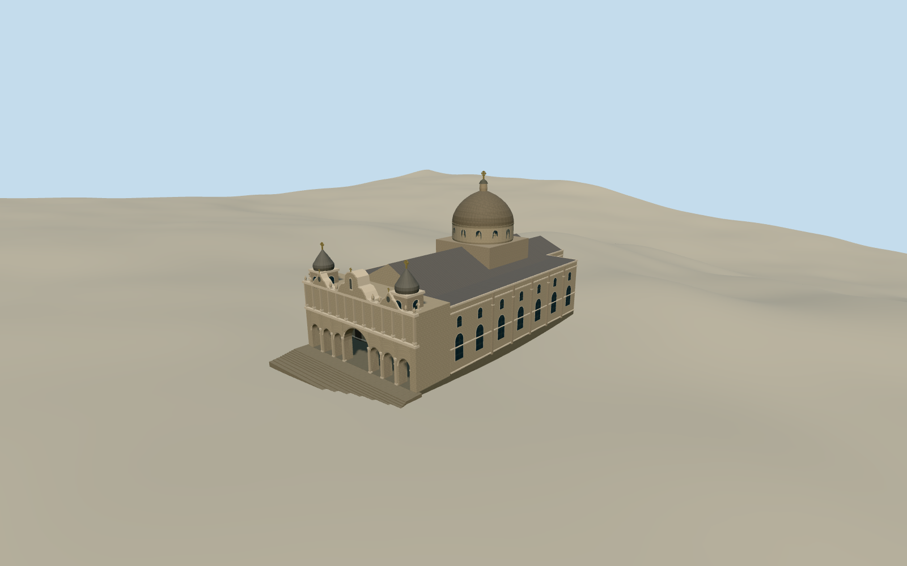

# Holy Trinity Cathedral, Addis Ababa

Holy Trinity Cathedral in Addis Ababa with its open western arcade, wide steps, twin bulbous turrets, prominent dome, and the east sanctuary.

Authoring state: **review-in-qa.json**. Current completion evidence is in [qa.json](qa.json) and the [completion ledger](../../../../qualla-structures/batches/qualla-003.PROGRESS.md).

- [Holy Trinity Cathedral, Addis Ababa](https://qualla.com/holy-trinity-cathedral-addis-ababa/)

Main west facade proportions are reconstructed from the archive photographs. Side and rear elevations, the precise central drum and dome, restoration-era finish and individual statuary are exterior estimates.

The model covers the cathedral and entry sequence. The separately mapped museum, graves and compound buildings are outside its scope.

Build: `node content/worldgen/source/places/sc/sce/holy_trinity_cathedral_addis_ababa/models/generate-holy-trinity-cathedral-addis-ababa.mjs`. Add `--check` to verify exact regeneration. 8374 triangles; 8 materials; no embedded photographs.
