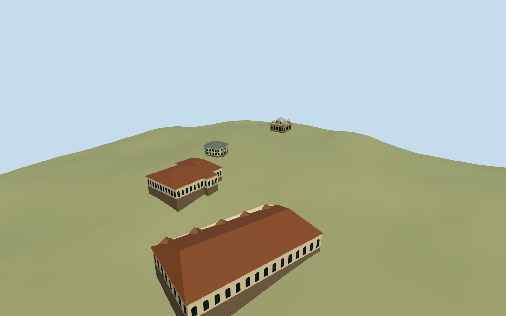

# Menelik Palace

Historic imperial residence, Throne House, Banquet Hall and domed Baeta Maryam mausoleum on the Great Ghebbi ridge in Addis Ababa.

Authoring state: **review-in-qa.json**. Current completion evidence is in [qa.json](qa.json) and the [completion ledger](../../../../qualla-structures/batches/qualla-003.PROGRESS.md).

- [Menelik Palace](https://qualla.com/menelik-palace/)

Meshes cover four historic exteriors only. The balance of the palace compound, additions, grounds and interiors are outside scope.

The archive photos control the four massings and the mausoleum’s arcades, drum and domes. Roof sections, window placement and later restoration finishes of the residence and halls are estimates.

Footprints and headings come from current map outlines. Original Terrarium sampling controls the sloped site; precise threshold heights are estimates.

Build: `node content/worldgen/source/places/sc/sce/menelik_palace/models/generate-menelik-palace.mjs`. Add `--check` to verify exact regeneration. 14335 triangles; 8 materials; no embedded photographs.
