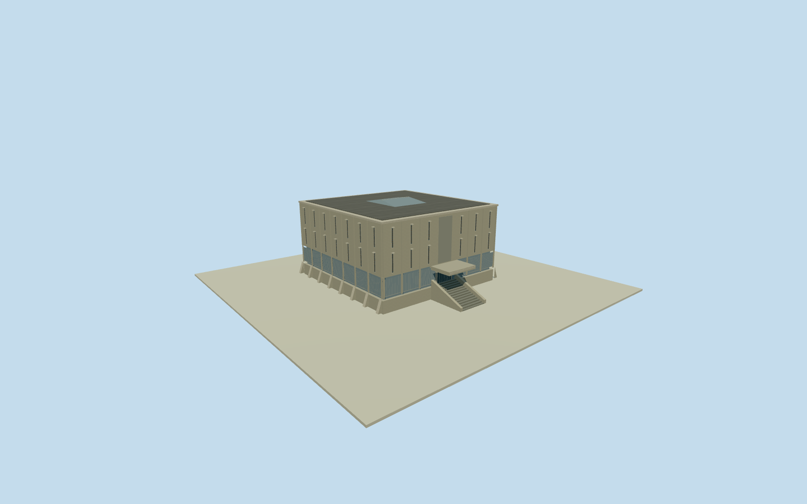

# National Museum of Ethiopia

National Museum of Ethiopia permanent gallery, with board-formed concrete fins, raised glazing and an east entry stair.

Authoring state: **review-in-qa.json**. Current completion evidence is in [qa.json](qa.json) and the [completion ledger](../../../../qualla-structures/batches/qualla-003.PROGRESS.md).

- [National Museum of Ethiopia](https://qualla.com/national-museum-of-ethiopia/)

September 2016 exterior of the permanent exhibition building. The adjacent temporary exhibition and museum grounds are outside this model.

The artwork above the main entrance is represented by a plain recess. The attached sign, roof profile and the less visible west wall are simplified.

Entrance grade and facade dimensions are approximate. The 128-meter source elevation field is preserved without grading or flattening.

Build: `node content/worldgen/source/places/sc/sce/national_museum_of_ethiopia/models/generate-museum.mjs`. Add `--check` to verify exact regeneration. 2866 triangles; 5 materials; no embedded photographs.
