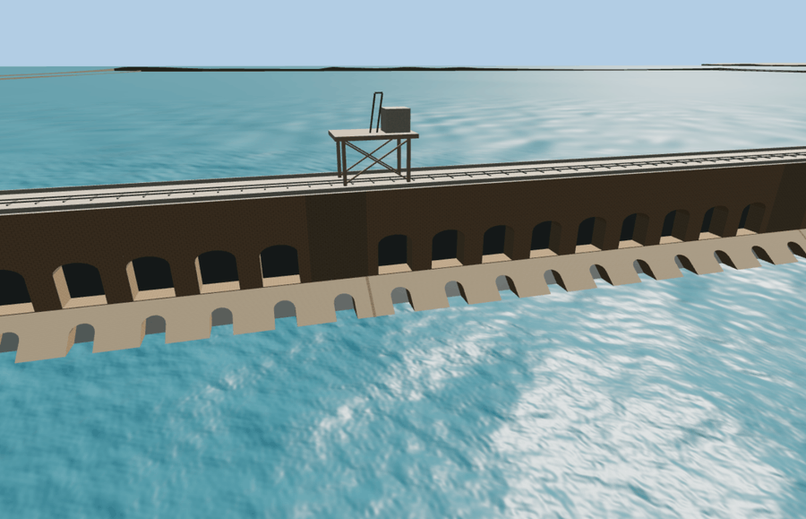

# Sennar Dam

The model reproduces the 600 m sandstone gravity wall, 80 low sluices and 72 upper arched apertures, plus the crest railway, traveling gantry, embankments and two irrigation intakes.

The PMTiles crest rail establishes the signed placement. Two local grades tie the retained rail approaches to the model. The Blue Nile uses a representative 421.7 m reservoir and 410.3 m tailwater. A 416 m canal stage leaves both intake gates visible.

The viewer replaces three overlapping fragments of the retained bridge rail and preserves 209 other transportation records. A failed model load restores all 212 records. Eviction restores the ground and releases the model geometry.

| Detail level | Triangles | Download bytes | Draws |
| --- | ---: | ---: | ---: |
| skyline | 938 | 80,676 | 6 |
| district | 3,742 | 286,488 | 6 |
| street | 6,902 | 516,256 | 6 |
| closeup | 12,522 | 932,172 | 6 |

Skyline and district total 367,164 bytes. Six GLBs pass Khronos validation and contain zero embedded images. Five shared material graphs bind in the viewer. The review covers 80 renders and 275 geographic samples.

The fixed crest and water stages are representative estimates from retained maps, standard terrain and photos. The canal levels, embankment shoulders and gantry position are approximate. The sluices are static.

Terrain corrections depend on the host serving the Protomaps semantic IDs and height samples fine enough to resolve the graded shoulders.

[Mapped site frame](map-frame.json) · [Terrain and water fit](site-fit.json) · [QA evidence](qa.json)
