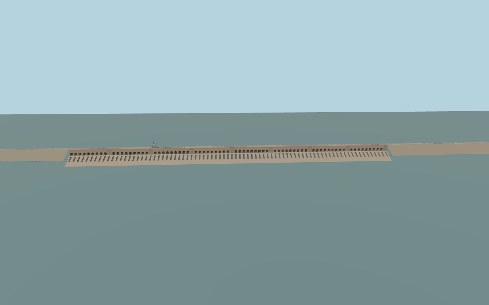

# Sennar Dam

Sennar Dam’s 600 m sandstone masonry wall, 80 lower sluices, 72 upper arched bays, crest rail and traveling gantry, approximate embankments, and the two mapped irrigation intakes.

Rebuild: `node packages/worldgen/scripts/generate-sennar-dam.mjs`;append `--check` for exact source bytes. Select import/LOD/placement with `--ids=sennar_dam`. Detailed source and four browser tiers are separate ignored GLB outputs.

The signed vertical origin is 423.544849 m. The 425.4 m crest is inferred from the standard terrain and the reservoir level. The reference fixture uses 421.7 m upstream, an illustrative 410.3 m tailwater, and 416 m for the canals.

The crest rail follows the 1779.02 m mapped bridge centerline. The masonry span, embankment shoulders, gate forms, traveling gantry position and headworks are reconstructed exterior approximations.

The standard upstream field samples 423.58 m. The canal reaches sample 423.65 m and 423.10 m in the comparison windows. The design fixture separates the native river polygon at the wall to show the reservoir and tailwater independently.

The dry shut gates are static. Submerged hydraulic works and operating discharge are outside this model.

Original geometry:repository license. Map:© OpenStreetMap contributors,ODbL-1.0;Protomaps. Standard terrain:terrain-grid.json. Ordinary pictures stay local and are not redistributed or used as textures. Current acceptance:qa.json.
