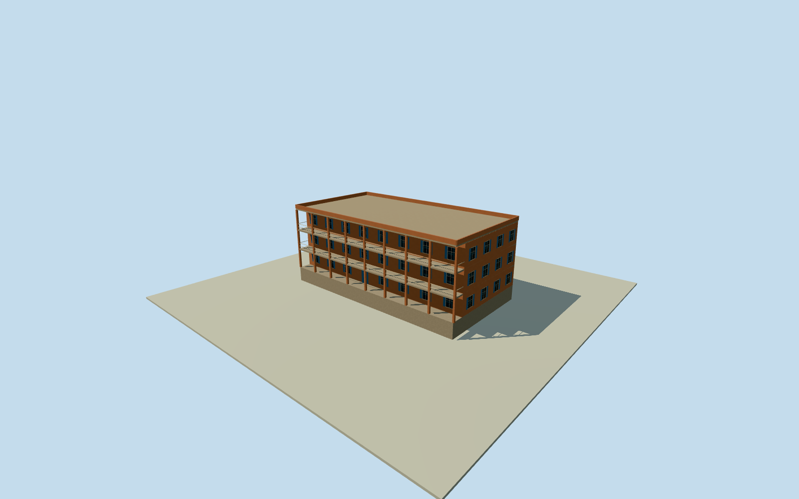

# Acropole Hotel — whole historical Khartoum hotel

Complete post1988 AcropoleHotelKhartoum physical main building, entire original four-control hotel outline/allthreefloors/allfacades/fullroof and intrinsic street patios/balconies. Primary first-hand NPR written three-storey/clay-color/blue-wood-shutter/street-patio and2023-2025damage phase facts, independent dated2012researcher room-balcony testimony. Original numerical z15 wholehotel way203863108 and paired namedAcropoleHotelPOI/Q4676414. All exact heights/roof/patio/balcony/door/window census/finish/grade estimates. Historical2020 intact building only; opposite pre1988hotel ruins and independentneighbors/interiors excluded, no current replacement.

Authoring state: **review-in-qa.json**. Current completion evidence is in [qa.json](qa.json) and the [completion ledger](../../../../qualla-structures/batches/qualla-002.PROGRESS.md).

- [Acropole Hotel](https://qualla.com/acropole-hotel/)

Complete post1988 AcropoleHotelKhartoum physical main building, entire original four-control hotel outline/allthreefloors/allfacades/fullroof and intrinsic street patios/balconies. Primary first-hand NPR written three-storey/clay-color/blue-wood-shutter/street-patio and2023-2025damage phase facts, independent dated2012researcher room-balcony testimony. Original numerical z15 wholehotel way203863108 and paired namedAcropoleHotelPOI/Q4676414. All exact heights/roof/patio/balcony/door/window census/finish/grade estimates. Historical2020 intact building only; opposite pre1988hotel ruins and independentneighbors/interiors excluded, no current replacement.

Primary first-hand NPR correspondent EmmanuelAkinwotu stayed about2020 and revisitedMay2025. Written report published15June2025 explicitly describes three-storey clay-colored hotel, blue wooden window shutters and street-facing patios, later damaged shutters/windows/gunfire after2023. DirectHTTP200 originalHTML cached, text only. Dated21November2012MedievalSaiProject researcher independently reports opening his room balcony door, directHTTP200. Every source photo/video/audio/figure unused.

Whole original20261029z15 four-control hotel way203863108 and paired same-ID AcropoleHotelPOI independently bound Q4676414. Current quantized numerical product used as approximate historical2020 registration; not original OSM nodes or measured floor/roof plan. Opposite pre1988bombed hotel ruins, independent neighbors and interiors excluded. Entire physical operating post1988hotel, all three storeys/all facades/fullroof/patios modeled.

All exact heights/sections estimated and frozen before geometry: providerrelativefloor0.35m, three equal3.5m levels, full roof slab10.85..11.1m and0.65m parapet to11.75m; basementbottom-2.15m. Source facts give no measured elevation or roof profile. Nominal2mheight uncertainty. Flat full roof/terrace and complete surrounding parapet are estimates, no surveyed rooftop claim.

All precise balcony/patio registration/census/roof details estimated: retain native full outer four-control line for foundation/floorplates/roof and patio outer support line; west-facing main wall inset2.1m from native longedge3to0 to supply genuine upper-floor patio depth. Two full-length upper-level patios at3.85m/7.35m, square concrete columns at estimated4.1mbays and simple paintedmetal rails. Patio ends/opening positions are unknown; nominal5m component registration uncertainty and20percentcensus uncertainty. No copied balcony/railing design or photograph-traced plan.

All window/door/shutter/rail/column census and proportions estimated. Blue wooden shutters follow primary written color/material, clay stucco wall color approximate, cream trim/concrete slabs/paintedmetal rails estimated. Shutter leaves/louvre detail are original procedural geometry; no source-pixel texture, historical photograph, graphic/sign/artwork copied. Interiors and personal/team photographs are not modeled. Patios retain complete floors/supports/rails; plants/individual furnishings excluded as minor movable details.

Original128m/16641-height independent field/single raw tile, datum392.0781m acquired before floors/mainsections. Sourcefield absolute386.253..396.5098m may contain coarse roof/canopy/urban artifacts and cannot prove historical ground contact. Preserve original frame/field/floors/mainsections during review; no ground mask/cutout/flatten/refetch/refit for pictures. Geographic vertical registration and grade contact unverified.

Dated2020-06-01 intact operating hotel only, valid until2021-06-01. NPR primary2025report documents war-damaged condition after2023, so no undamaged current-world replacement/automatic activation. Qualla-first22families, all imagery unused; questionable sources skipped without questions. Primary written architecture/phase and independent numeric whole-building map only; no photographic/survey claim.

Build: `node content/worldgen/source/places/sd/sdz/acropole_hotel/models/generate-house.mjs`. Add `--check` to verify exact regeneration. 3524 triangles; 6 materials; no embedded photographs.
