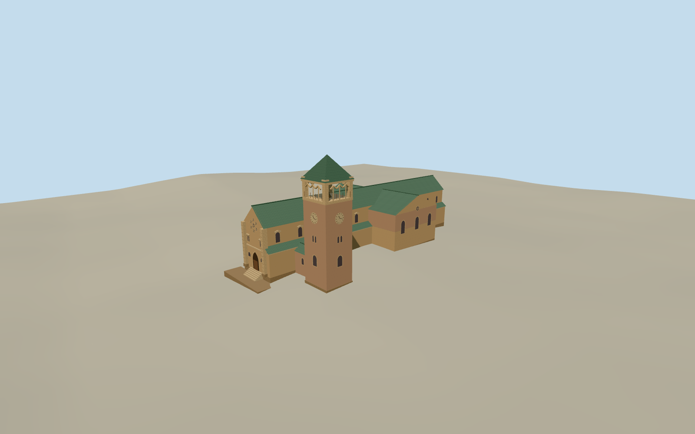

# Republican Palace Museum

The Republican Palace Museum occupies the former All Saints Cathedral in Khartoum. Its sandstone cruciform shell and glazed tile roofs flank a covered passage to the clock and bell tower.

Authoring state: **review-in-qa.json**. Current completion evidence is in [qa.json](qa.json) and the [completion ledger](../../../../qualla-structures/batches/qualla-003.PROGRESS.md).

- [Republican Palace Museum](https://qualla.com/republican-palace-museum/)

The museum exterior represents the 2007 phase on an approximate prewar reconstruction. Finish and form follow the original drawings and published material descriptions.

The exact finished tower dimensions, roof height, lantern treatment, east and north openings, and the extent of the historical terrace are estimates. The tower’s original published plan supplies its location within the grounds.

Build: `node content/worldgen/source/places/sd/sdz/republican_palace_museum/models/generate-republican-palace-museum.mjs`. Add `--check` to verify exact regeneration. 4731 triangles; 5 materials; no embedded photographs.
