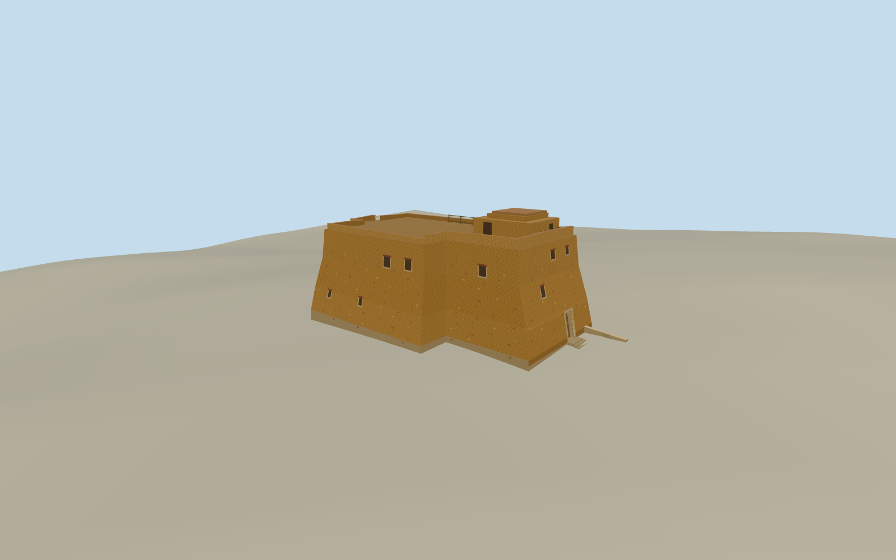

# Throne Hall of Dongola

The standing Throne Hall and mosque at Old Dongola with battered mud-brick walls, a sandstone west entry and conserved roof terrace above the Nile.

Authoring state: **review-in-qa.json**. Current completion evidence is in [qa.json](qa.json) and the [completion ledger](../../../../qualla-structures/batches/qualla-003.PROGRESS.md).

- [Throne Hall of Dongola](https://qualla.com/throne-hall-of-dongola/)

Roof enclosure, aperture positions and wall batter are approximated from the published silhouette and archaeological descriptions. The surviving standing state follows the documented 2015–2017 conservation.

The model represents the exterior, including the restored terrace, without reconstructing the earlier Makurian palace state, buried rooms or surroundings.

Build: `node content/worldgen/source/places/se/sej/throne_hall_of_dongola/models/generate-throne-hall-of-dongola.mjs`. Add `--check` to verify exact regeneration. 1250 triangles; 6 materials; no embedded photographs.
