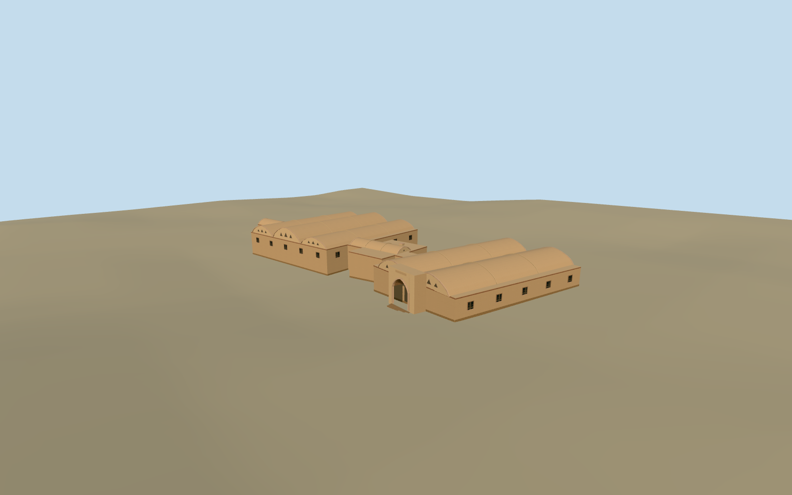

# Kerma Museum

The standing site museum in Kerma, with joined domestic-scale gallery ranges, rounded Nubian vaults with triangular light openings, and a deep west entrance facing the ancient city.

Authoring state: **review-in-qa.json**. Current completion evidence is in [qa.json](qa.json) and the [completion ledger](../../../../qualla-structures/batches/qualla-003.PROGRESS.md).

- [Kerma Museum](https://qualla.com/kerma-museum/)

Unaltered mapped ground and the connected building outline are used. The number and distribution of vaults, exact glazing, dimensions above the footprint, colour, and west doorway detailing are modeled estimates.

Kerma’s 2008-built museum form is represented. The standing connected ranges follow the single mapped outline. Internal room attribution, exhibits, the Western Deffufa and other cultural precinct properties are outside the reconstruction.

Build: `node content/worldgen/source/places/se/sem/kerma_museum/models/generate-kerma-museum.mjs`. Add `--check` to verify exact regeneration. 5813 triangles; 6 materials; no embedded photographs.
