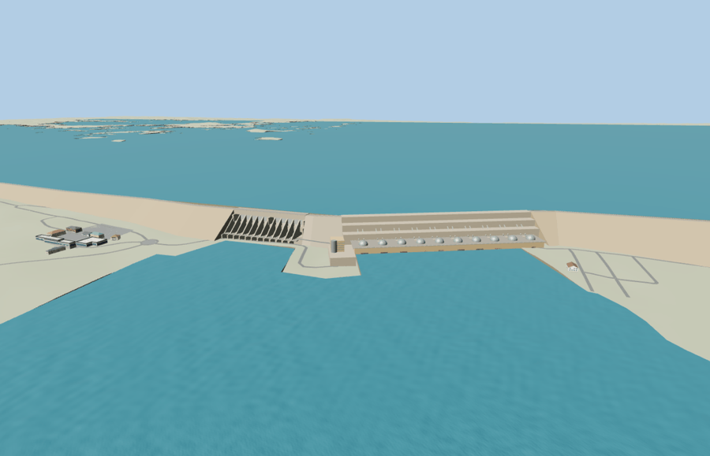

# Merowe Dam

The original geometry includes the curved 9.45 km embankment alignment, 154 m central spillway, twelve low-level recesses, two surface gate sections, ten domed turbine housings along the powerhouse, its service platform and rounded stair tower.

The Earth viewer holds the reservoir at the representative 300 m design pool below the 303 m crest. The downstream Nile uses a continuous 259.67 m stage along the spillway and powerhouse. The buried intake line stays below the model. Both embankment ties, the spillway, and the lower powerhouse remain visible. The review fixture retains all 78 building and 63 road records.

Failed loading preserves the native layers. Eviction restores the ground and releases model geometry.

| Detail level | Triangles | Download bytes | Draws |
| --- | ---: | ---: | ---: |
| skyline | 994 | 85,032 | 6 |
| district | 2,478 | 204,884 | 7 |
| street | 5,942 | 475,976 | 7 |
| closeup | 7,822 | 624,776 | 7 |

Skyline and district total 289,916 bytes. Six GLBs pass Khronos validation and contain zero embedded images. Six shared material graphs bind in the viewer. The review covers 78 renders and 80 geographic samples.

The model shows static representative stages and approximate shore and embankment contact from standard map and terrain tiles. The native terrain partially covers low retaining slopes toward both bank ends.

The exterior depicts the spillway and turbine hall architecture. Hidden machinery and operating discharge are outside its scope.

[Mapped site frame](map-frame.json) · [Terrain and water fit](site-fit.json) · [QA evidence](qa.json)
