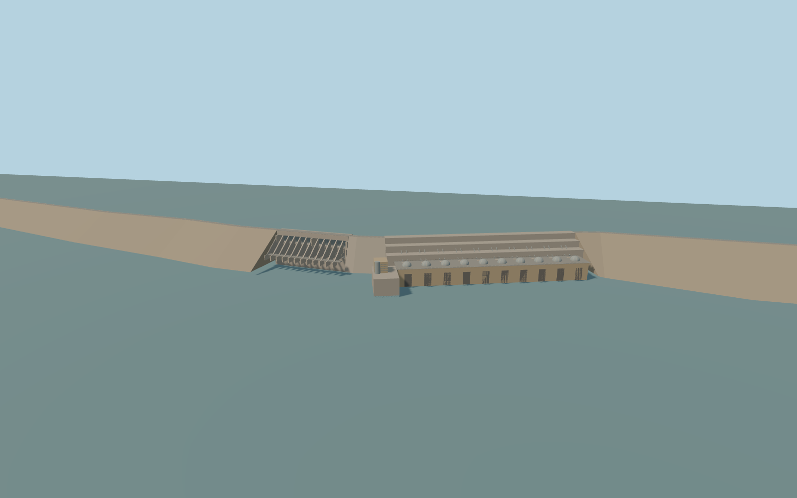

# Merowe Dam

Merowe Dam’s west and east embankments, central spillway with twelve low sluices and two surface gates, angled intake dam, ten domed turbine housings, powerhouse and immediate service structures.

Rebuild: `node packages/worldgen/scripts/generate-merowe-dam.mjs`;append `--check` for exact source bytes. Select import/LOD/placement with `--ids=merowe_dam`. Detailed source and four browser tiers are separate ignored GLB outputs.

Absolute mean-sea-level placement fixes the modeled crest at 303 m. The design full pool is 300 m. With the retained PMTiles shorelines and standard Terrarium terrain, the runtime water sampler gives 252.43–271.86 m in central reservoir tiles and 250.22–255.31 m in the tailwater. Changing the terrain provider does not move the dam.

The crest follows a 9.45 km traced alignment. End ties, embankment cross sections, the internal structure of the spillway and exterior service machinery are approximate.

Site fit remains pending with standard runtime data. The sampled reservoir is 28–48 m below design pool, and the near tailwater varies by tile. The design pool is used only in the review fixture.

Native buildings and service roads retain their geometry. The original terrain stays unchanged outside the explicitly occupied hydraulic openings. Substation equipment away from the dam, buried works and gate operation are outside this asset.

Original geometry:repository license. Map:© OpenStreetMap contributors,ODbL-1.0;Protomaps. Standard terrain:terrain-grid.json. Ordinary pictures stay local and are not redistributed or used as textures. Current acceptance:qa.json.
