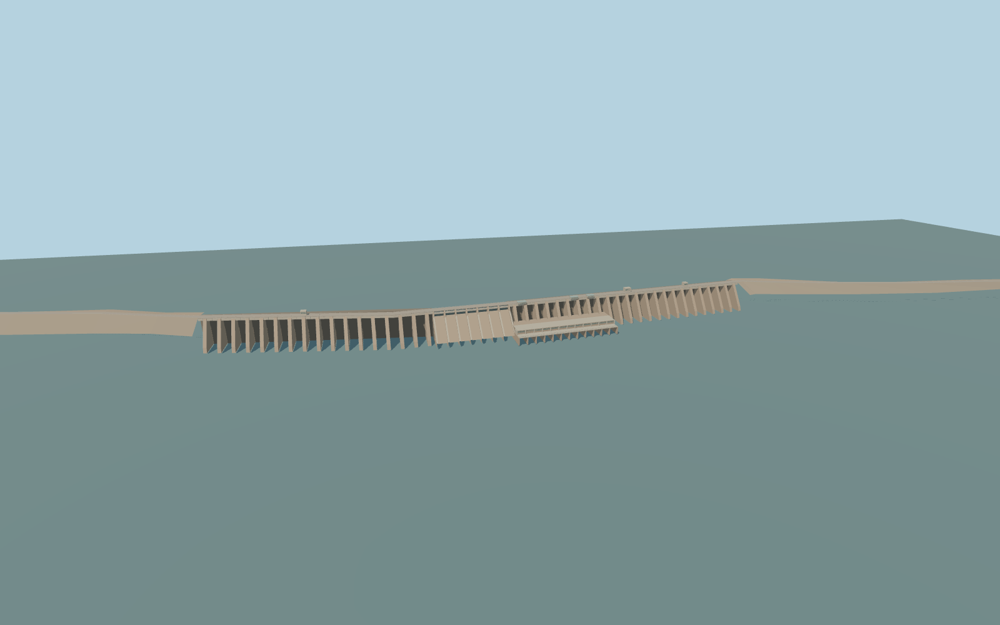

# Roseires Dam

Roseires Dam’s signed concrete barrage and approach embankments, photographed buttresses, the central sluice chutes, power hall and downstream apron.

Rebuild: `node packages/worldgen/scripts/generate-roseires-dam.mjs`;append `--check` for exact source bytes. Select import/LOD/placement with `--ids=roseires_dam`. Detailed source and four browser tiers are separate ignored GLB outputs.

Standard Terrarium samples set the 483.02 m reservoir anchor at [0, −640] and the 451.00 m downstream channel at [0, 208]. The production sampler returns 483.62–483.65 m upstream and 450.48–452.77 m across the sampled downstream polygons.

The original model follows the 934 m mapped concrete outline and the adjacent mapped grade ties. More distant perimeter embankments remain in native terrain.

The visible wall, seven gated lanes and low power hall follow the ordinary reference pictures and PMTiles alignment. Exact current gate, buttress, apron and machinery dimensions are visual interpretations.

The 16 m terrain and modeled shore grades are approximate. Only the crest crossing is replaced. Both downstream bridges remain native.

Original geometry:repository license. Map:© OpenStreetMap contributors,ODbL-1.0;Protomaps. Standard terrain:terrain-grid.json. Ordinary pictures stay local and are not redistributed or used as textures. Current acceptance:qa.json.
