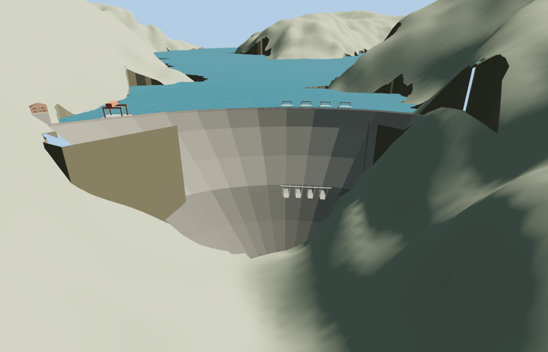

# Tekezé Dam

The model reproduces the 420 m double-curvature arch, four recessed midlevel outlet mouths, four raised gate headworks, the separate power intake crane and the south thrust block.

The signed placement fixes the 420 m arch at its 1145 m crest and the reservoir at 1140 m. The model trims mapped reservoir overlap along its upstream concrete face. The Earth fixture checks that native water no longer passes through the entire length of the sampled crest while preserving the downstream road, tunnel and building features.

The Earth fixture retains all three mapped service road records. The ground opening follows the upper central arch. Failed loading preserves the native layers. Eviction restores the ground and releases model geometry.

| Detail level | Triangles | Download bytes | Draws |
| --- | ---: | ---: | ---: |
| skyline | 660 | 54,248 | 4 |
| district | 926 | 74,988 | 4 |
| street | 1,286 | 101,928 | 4 |
| closeup | 1,336 | 105,836 | 4 |

Skyline and district total 129,236 bytes. Six GLBs pass Khronos validation and contain zero embedded images. Three shared material graphs bind in the viewer. The review covers 64 renders and 100 geographic samples.

The retained PMTiles around the toe have a short river centerline and no continuous tailwater polygon. The terrain review fixture uses an illustrative downstream corridor. Outer reservoir banks remain angular in the coarse raster, which also obscures part of the south thrust block.

The model shows static closed gates. Underground generation and operating discharge are outside the modeled exterior.

[Mapped site frame](map-frame.json) · [Terrain and water fit](site-fit.json) · [QA evidence](qa.json)
