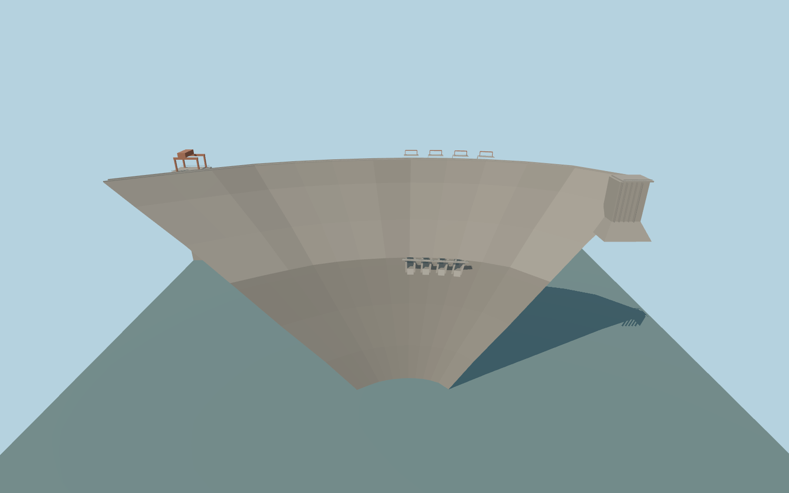

# Tekezé Dam

Tekezé Dam’s 420 m double-curvature arch, four recessed midlevel outlets, upstream gate headworks, power intake crane and south thrust block.

Rebuild: `node packages/worldgen/scripts/generate-tekeze-dam.mjs`;append `--check` for exact source bytes. Select import/LOD/placement with `--ids=tekeze_dam`. Detailed source and four browser tiers are separate ignored GLB outputs.

The signed vertical origin is 1001.601962 m. The fixed crest is at 1145 m. The design fixture uses 1140 m maximum retention. The representative sample of standard upstream terrain gives 1012.03 m.

The crest follows the river mouth and reservoir-facing rock shoulders. The dam section, approach tie, headwork dimensions and outlet machinery are exterior approximations.

The retained standard field places the sampled reservoir about 128 m below the design fixture. The design fixture clips water at the modeled upstream face and uses an illustrative downstream corridor based on the mapped river line.

The underground generating station, bypass tunnels and operating flows are outside the exterior model.

Original geometry:repository license. Map:© OpenStreetMap contributors,ODbL-1.0;Protomaps. Standard terrain:terrain-grid.json. Ordinary pictures stay local and are not redistributed or used as textures. Current acceptance:qa.json.
