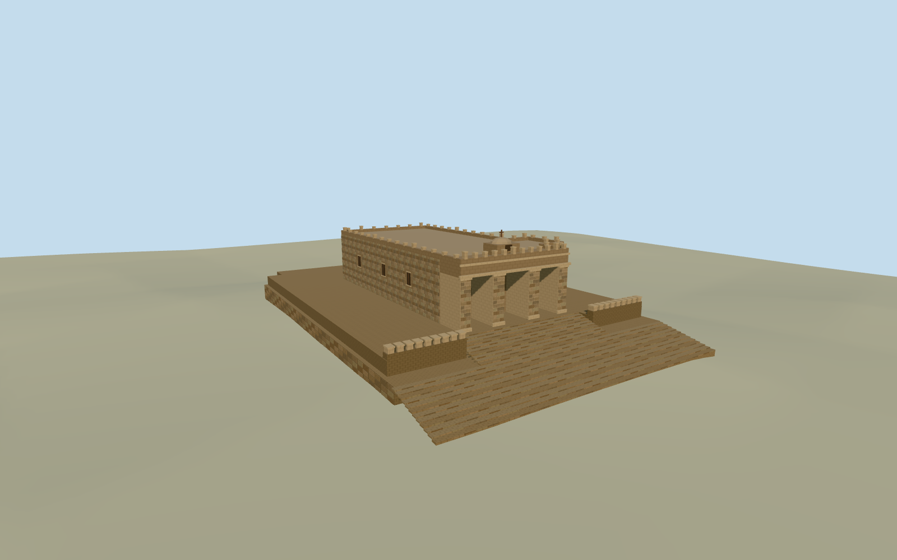

# Old Church of Our Lady Mary of Zion

The Old Cathedral at Aksum in 1893, with three lintelled portico openings, flat crenellated roof, and a broad double flight of steps on the Aksumite podium.

Authoring state: **review-in-qa.json**. Current completion evidence is in [qa.json](qa.json) and the [completion ledger](../../../../qualla-structures/batches/qualla-004.PROGRESS.md).

- [Church of Our Lady Mary of Zion](https://qualla.com/church-of-our-lady-mary-of-zion/)

The model depicts the pre-1908 church appearance. The mapped envelope is the standing building, so historic side projections are approximate.

The rear elevations, roof finish, masonry colors and south and east podium edges are interpreted from the single detailed period photograph and the published measurements.

Scope includes the cathedral, its platform and the approach steps. The later new cathedral, treasuries, adjacent belfries and other precinct buildings are outside this model.

Build: `node content/worldgen/source/places/sf/sfe/old_church_of_our_lady_mary_of_zion/models/generate-old-church-of-our-lady-mary-of-zion.mjs`. Add `--check` to verify exact regeneration. 31992 triangles; 6 materials; no embedded photographs.
