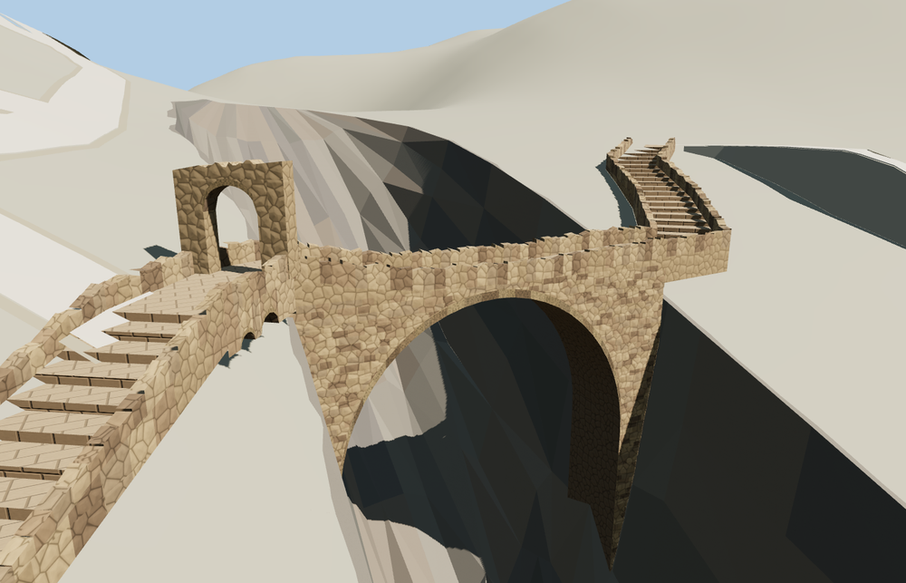

# Shaharah Bridge

A single open limestone vault spans Shaharah’s narrow rocky gorge. The model follows the mapped footbridge, with a shallow stepped deck, rough parapets, a west gateway, small retaining-wall arches, and stairs along the east cliff.

The named Shahara Bridge way 317112492 and the two connected paths establish the signed crossing associated with Q3397149. The smoothed terrain is cut only along the gorge relief. The arch and gate remain open at all four tiers, and both authored stairs meet the retained footpaths. The original terrain and mapped bridge path return when the model fails to load.

The 7,884-triangle source rebuilds byte for byte. The first two runtime tiers total 215,892 bytes. Six GLBs validated and 36 current views were inspected.

The named PMTiles footbridge and connected paths fix the placement and signed alignment. Vault dimensions, stair rise, gate profile, and stonework are exterior photo interpretations. The elevation grid flattens the slot under the bridge. A small authored relief patch reconstructs that slot and blends into the sampled terrain. Its rock detail and gorge depth are visualization approximations.

Rebuild with `node packages/worldgen/scripts/generate-vushtrri-stone-bridge.mjs`. Append `--check` to compare exact bytes. Use `--ids=vushtrri_stone_bridge` for targeted import, LOD, placement and readiness.
