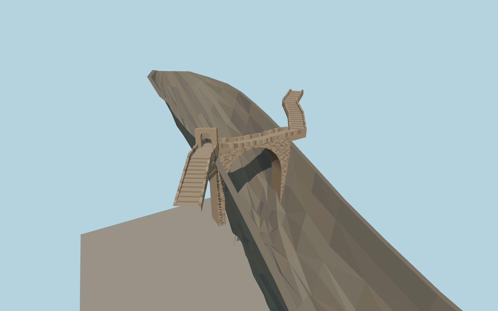

# Shaharah Bridge

A single open limestone vault spans Shaharah’s narrow rocky gorge. The model follows the mapped footbridge, with a shallow stepped deck, rough parapets, a west gateway, small retaining-wall arches, and stairs along the east cliff.

Run `node packages/worldgen/scripts/generate-shaharah-bridge.mjs` to rebuild the source master. Append `--check` to compare the exact bytes. Use `--ids=shaharah_bridge` for targeted import, LOD generation and placement.

The named PMTiles footbridge and connected paths fix the placement and signed alignment. Vault dimensions, stair rise, gate profile, and stonework are exterior photo interpretations.

The elevation grid flattens the slot under the bridge. A small authored relief patch reconstructs that slot and blends into the sampled terrain. Its rock detail and gorge depth are visualization approximations.

Original geometry follows the repository license. Map data is © OpenStreetMap contributors under ODbL-1.0 via Protomaps. Terrain samples are described in terrain-grid.json. Ordinary pictures stay local and are not redistributed or used as textures. Current acceptance is recorded in qa.json.
