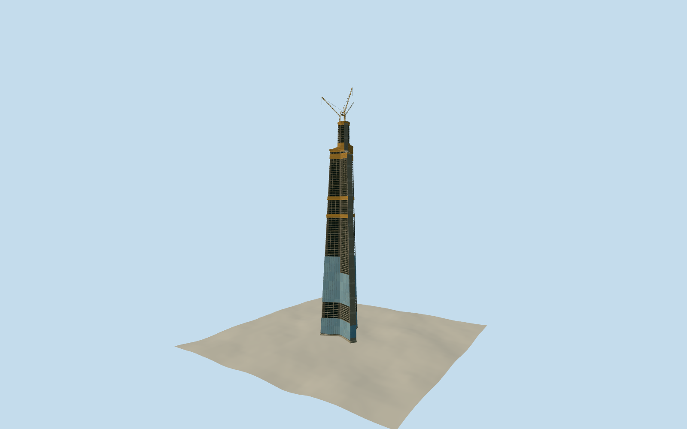

# Jeddah Tower

Jeddah Tower under construction at the 120th-floor milestone, with its exposed concrete wings, partly glazed envelope, ochre work platforms and cranes.

Authoring state: **review-in-qa.json**. Current completion evidence is in [qa.json](qa.json) and the [completion ledger](../../../../qualla-structures/batches/qualla-003.PROGRESS.md).

- [Jeddah Tower](https://qualla.com/jeddah-tower/)

This is the 2 November 2026 construction snapshot. The cleared exterior photograph dates to May 2026 at about 100 floors. Upper wing deck positions, formwork, cranes and the progression of the glass toward November are estimated.

The finished tower, neighboring construction and underground works sit outside the model scope. Floor spacing varies in the real building. The host terrain is the original Terrarium surface and local concrete foundation depth is an estimate.

Build: `node content/worldgen/source/places/sg/sgg/jeddah_tower/models/generate-jeddah-tower.mjs`. Add `--check` to verify exact regeneration. 29037 triangles; 4 materials; no embedded photographs.
