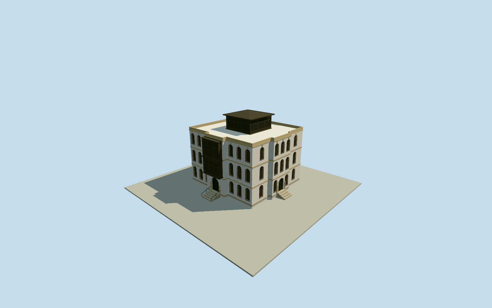

# Nasseef House

Photo-guided full stepped white coral/plaster merchant house with pale ochre floor bands, grouped tall round-headed wood shutters and upper circular vents, two stacked projecting carved-wood rawashin above the north entrance, terrace parapets, central dark wooden lattice roof pavilion/overhanging hip roof and own short entry steps. Native named point verifies identity nearby; the plan, dimensions and hidden elevations are expressly estimated.

Authoring state: **review-in-qa.json**. Current completion evidence is in [qa.json](qa.json) and the [completion ledger](../../../../qualla-structures/batches/qualla-002.PROGRESS.md).

- [Nasseef House](https://qualla.com/nasseef-house/)

Named OSM node2520141053 and independently decoded ProtomapsPOI17594706185469 match the story nearby. Neither current extract provides a containing house roof polygon; unrelated generic building footprints40+maway are not adopted. Full stepped22x21mplan, anchor attachment, setbacks and hidden elevations are photographic estimates at the story coordinate, not a survey or native roof plan.

The exact cleared Qualla-published434x640UserCyb3r1998PD-selforiginal controls white stepped wall masses, pale ochre floor bands, tall round-headed wood shutters/upper vents, two stacked projecting north-door rawashin, terraces and wooden roof pavilion. Body14.8m, pavilion/roof19.35m, row openings, lattice sections, roof form and entry steps are medium-fi estimates at this limited image detail. Offset internal levels are not asserted as seven identical visible exterior storeys.

Complete exterior assembly only. Wood screens have physical posts/rails/fine lattice with recessed dark backing; panes, ordinary shutters/doors and hidden rooms are closed. Fine lattice, shutter slats, vent rims and handles retire in lower LODs. Interiors/cisterns/kitchen, inscriptions, temporary restoration works/foreground barriers, tree, neighboring houses and street landscape excluded.

Foundations extend.4m below a fixed northern dry-approach datum; own short steps rise1.05m. Exact house footprint, doorstep/ground attachment and host terrain are approximate, with source terrain preserved and no whole-square platform or blanket ground opening.

Build: `node packages/worldgen/scripts/generate-authored-places.mjs --ids=nasseef_house`. Add `--check` to verify exact regeneration. 36374 triangles; 6 materials; no embedded photographs.
