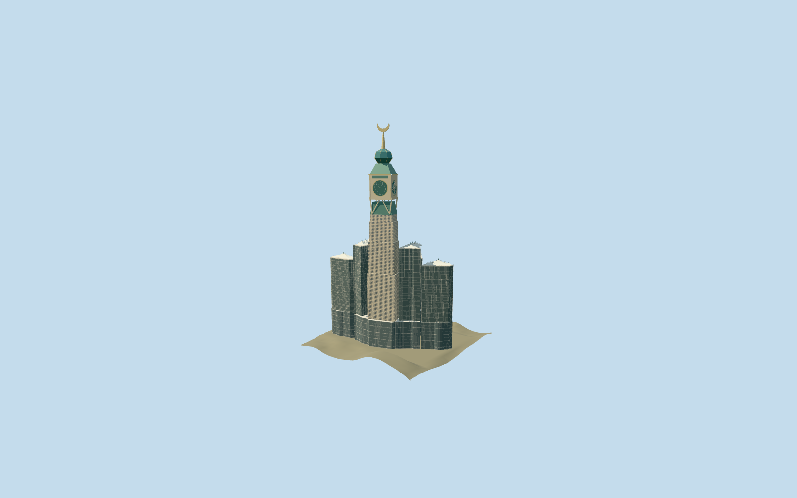

# Abraj Al Bait

Compact Abraj complex retains the mapped podium and six surrounding towers, cardinally aligned offset clock tower, four dials, V supports, glass jewel, gold spire and solid crescent. Original detailed master remains reproducible; browser levels simplify repeated facades and ornaments.

## Evidence and reconstruction

Published dimensions and reconstructed details are separated in spec.json. Primary references:

- [Reference](https://www.sl-rasch.com/en/projects/the-makkah-royal-clock-tower/)
- [Reference](https://www.sl-rasch.com/en/projects/tower-tents/)
- [Reference](https://www.perrot-turmuhren.de/turmuhren-laeuteanlagen-sonderuhren-turmzieren-glockenspiele/besondere-uhren-spezialuhren/groesste-turmuhr-makkah-clock.html)
- [Reference](https://www.openstreetmap.org/way/958867174)
- [Reference](https://www.openstreetmap.org/relation/12896421)

No third-party geometry, photograph or bitmap texture is embedded. Shared surface graphs come from the central library; vertex tints carry model colors. Glazing uses PBR materials; transparent surfaces are declared per model.

## Model and axes

63,274 triangles; 189,822 vertices; 6 material groups; 7,596,512 bytes. Native bounds: -174.170, 0.000, -114.195 to 174.184, 601.000, 114.431. Source hash: `sha256:ac5a34e3d1894ecb3f0e75342de0e1af0deff72c9c66336b13905c0e271eb00b`.

{"up":"+Y","longitudinal":"+X along the mapped building long axis","front":"+Z","origin":"Mapped whole-complex frame; clock shaft offset to exact-QID building:part center, faces cardinal directions"}

Inspected a contractor clock-construction photograph and a completed lower-tower/tent photograph. They establish the large gold-edged dial, warm ribbed hotel facades and pale tensioned roof tents; they do not certify the completed crescent or exact whole-complex crown. Preserve original601m source height,23m crescent and existing mapped seven-tower/podium layout. Main clock shaft remains separately offset at[39.82553895,21.41812445] and internally aligned cardinally; six named lower parts retain their plans and authored heights. Standard viewer PMTiles confirms the Great Mosque/complex context. Off-podium PMTiles point[0,140]328.125m sets approximate ground contact; center333.3364m and nearby hills are coarse. Rectangular preview contact correction covers the complex, with raw terrain kept separately. Exact tent sag, clock typography, calligraphy, mosaic ornament, entrances and thresholds remain approximate or omitted. Existing601/607m datum disagreement remains documented; no new survey is claimed.

## Reproduce

Run `node packages/worldgen/scripts/generate-signature-towers.mjs --ids=N0142` (or add `--check`). The generator preserves manually edited masters by checking their baseline hashes. Import through the standard authored-model workflow with optimization disabled; then capture all QA cameras, including shared-surface views.

## Pending work

- Inspected a contractor clock-construction photograph and a completed lower-tower/tent photograph. They establish the large gold-edged dial, warm ribbed hotel facades and pale tensioned roof tents; they do not certify the completed crescent or exact whole-complex crown. Preserve original601m source height,23m crescent and existing mapped seven-tower/podium layout. Main clock shaft remains separately offset at[39.82553895,21.41812445] and internally aligned cardinally; six named lower parts retain their plans and authored heights. Standard viewer PMTiles confirms the Great Mosque/complex context. Off-podium PMTiles point[0,140]328.125m sets approximate ground contact; center333.3364m and nearby hills are coarse. Rectangular preview contact correction covers the complex, with raw terrain kept separately. Exact tent sag, clock typography, calligraphy, mosaic ornament, entrances and thresholds remain approximate or omitted. Existing601/607m datum disagreement remains documented; no new survey is claimed.
- Three common granite/painted-metal/canvas graphs reused across semantic slots, with opaque glass/dial PBR and no copied photographs. Low tiers merge small perimeter edges and facade grids, omit railings and minute ticks, and retain all towers and major crown forms. Closeup includes representative original geometric numeral strokes. Physical-device timings pending.

This bundle follows the medium-fi standard. Medium-fi appearance and geographic fit are reviewed separately. Hash-bound visual acceptance is recorded separately after capture inspection.
