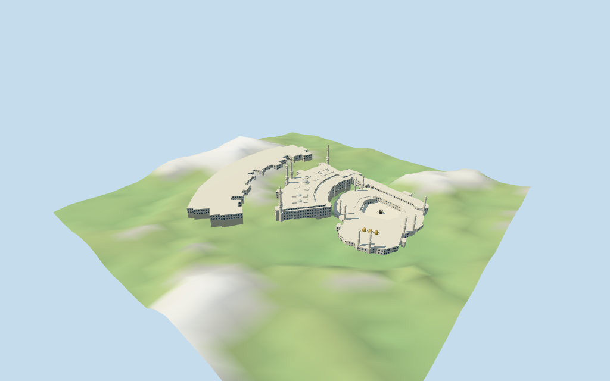

# Al-Masjid Al-Haram

Individual medium-fi Great Mosque campus:three mapped expanded/old wings,open-sky white Mataf court with the individually oriented black-and-gold Kaaba,Hatim and Maqam Ibrahim;long Sai gallery,stepped pale marble roofs,small roof domes,arcaded facades and thirteen mapped minaret groups. Shared materials and four authored browser levels. Current raw map controls retained;construction state,fine profiles and exact terrain joins remain approximate or unverified. Abraj Al Bait excluded.

## Evidence and reconstruction

Published dimensions and reconstructed details are separated in spec.json. Primary references:

- [Reference](https://commons.wikimedia.org/wiki/File:Masjidil_Haram,_Mekah_Al-Mukaramah,_Arab_Saudi.jpg)
- [Reference](https://commons.wikimedia.org/wiki/File:Exterior_of_the_Grand_Mosque_of_Makkah,_Saudi_Arabia_and_the_Clock_Tower_(52500933887).jpg)
- [Reference](https://commons.wikimedia.org/wiki/File:Masjidul-HaramAerialView_(cropped).jpg)

Five existing shared256² marble,limestone,painted metal,canvas and bronze graphs,seven merged material groups including local glazing. Linear tints,metric UVs,flat architectural normals;no embedded images,bespoke facade photographs or baked light. Kaaba gold bands are abstract fields without invented writing.

## Model and axes

63,782 triangles; 191,346 vertices; 7 material groups; 7,658,092 bytes. Native bounds: -424.919, -30.415, -365.869 to 424.869, 133.798, 365.850. Source hash: `sha256:f99d1e9048db4d103bd2b5a957e624424c367961ac178164b5b3f71f978a8025`.

{"x":"south-southeast toward old Mataf/Kaaba and separate clock tower","y":"up","z":"west-southwest"}

Standard viewer DEM datum324.890903m. Main perimeter ranges-28.68 to37.44m relative to the anchor. Separate wing floors 20.460/-3.702/-30.065m use representative coarse samples plus0.5m;the old court sample is at the Kaaba. These are approximate terraces,not surveyed courtyard levels. Adaptive foundations crossY=0 and extend to retained ground. Height bands are relative to each wing floor;connector profiles are approximations. A visible-model ground cutout follows the mapped old-mosque outer polygon,with model-owned marble paving at its declared floor;this prevents coarse DEM from covering the Mataf and old wings. The review heightmap represents that replacement with a6.5m grid/7m edge transition;the original unmodified DEM grid is retained in pmtiles-fit.json. Newer wings retain coarse terrain and may show base burial. Exact altitude,base/road/court contact,steps,thresholds and walking remain unverified. No broad terrain flattening or road replacement.

## Reproduce

Run `node packages/worldgen/scripts/generate-additional-landmarks.mjs --ids=N0412` (or add `--check`). The generator preserves manually edited masters by checking their baseline hashes. Import through the standard authored-model workflow with optimization disabled; then capture all QA cameras, including shared-surface views.

## Pending work

- Retained relation/1472531 /Q428858 identifies Al-Masjid Al-Haram. Current standard viewer PMTiles whole52776559605779 has three campus polygons and a courtyard hole; 609 selected parts plus separately mapped Kaaba35184476003401,Hatim35184688000726 and Maqam Ibrahim35184845390211 are retained. The same campus is one asset; separately authored N0142 Abraj Al Bait remains excluded. Anchor[39.824134536,21.424422395] and heading−1.297856525426rad retained without horizontal rescale. Native+X south-southeast toward the old Mataf/Kaaba and clock-tower side,−X north-northwest toward the expanded outer wing,+Z west-southwest. Pictures and map control signed facing;approximate3° uncertainty.
- Map heights are nominal:outer relation21m;central lower hall35.5m/upper roof42m,central dome54.5m with lower51m control,four smaller domes48m/twelve roof pavilions46m;old Mataf21m,Sai30m with34m roof blocks;C-shaped inner gallery roof9.5m;south hall21m with33m domes. Nine old minaret groups end84.3m and four newer groups137.5m. Retain all bands,including inconsistent min_height89/height84.3 tips,but never render inverted solids. Estimated coherent radial profiles,lantern columns,balcony parapets,caps and finials replace tiny map ornament boxes. Kaaba15m with cloth/gold bands at8.75/11.75/14.6m;Hatim1.23m,Maqam2.5m. Fine architecture and untagged outer-wing/south-hall heights are estimates. Retained Wikidata137.5m height lacks linked reference URLs and is only a consistency hint.
- Standard viewer DEM datum324.890903m. Main perimeter ranges-28.68 to37.44m relative to the anchor. Separate wing floors 20.460/-3.702/-30.065m use representative coarse samples plus0.5m;the old court sample is at the Kaaba. These are approximate terraces,not surveyed courtyard levels. Adaptive foundations crossY=0 and extend to retained ground. Height bands are relative to each wing floor;connector profiles are approximations. A visible-model ground cutout follows the mapped old-mosque outer polygon,with model-owned marble paving at its declared floor;this prevents coarse DEM from covering the Mataf and old wings. The review heightmap represents that replacement with a6.5m grid/7m edge transition;the original unmodified DEM grid is retained in pmtiles-fit.json. Newer wings retain coarse terrain and may show base burial. Exact altitude,base/road/court contact,steps,thresholds and walking remain unverified. No broad terrain flattening or road replacement.
- Pictures from2012/2022/2024 guide exterior recognition;latest construction/restoration finish is unverified. PMTiles supplies current expanded outline,not a verified detailed reconstruction of the newer wing. Fine carving,inscriptions,engineering/interiors,precise gallery plans,roof equipment,temporary cranes/scaffolds,people and construction are excluded or abstracted. Selected arcade fields are recessed;others are draw-limited opaque facade fields,not traversable galleries. Minaret lanterns have simplified columns and cores;far levels merge them. Separately authored Abraj Al Bait remains host content. Old-campus marble paving,Kaaba,Hatim and Maqam are intentionally modeled and included in replacement coverage;open sky does not mean an empty viewer footprint. The localized old-mosque ground cutout restores when the model unloads. Approximate terraced bases/coarse DEM fit and connector profiles do not establish exact ground levels or accessible walking. Physical phone/laptop timing remains unverified.

This bundle follows the medium-fi standard. Medium-fi appearance and geographic fit are reviewed separately. Hash-bound visual acceptance is recorded separately after capture inspection.

## Additional geographic data

©OpenStreetMap contributors;Protomaps;Mapzen/USGS terrain tiles.
