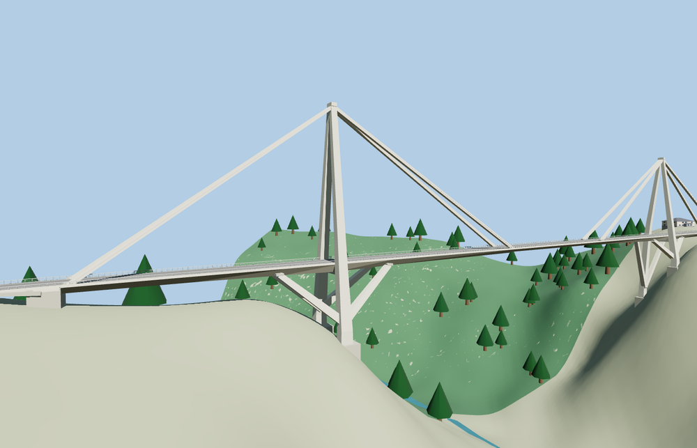

# Wadi el Kuf Bridge

Two slender concrete towers rise above the straight gorge crossing. Paired sheathed stays meet the narrow highway deck and V frames brace it from below. A shallower center segment, guardrails, curb strips and graded approaches follow the mapped road.

The 21,724-triangle source rebuilds byte for byte. Skyline, district, street and close-up use 984, 3,484, 6,756, 17,788 triangles. Skyline and district total 350,460 bytes. Six GLBs validated and 36 current views were inspected.

Four tower footings, two abutments, eight brace probes, 32 deck probes and six landing samples pass at every tier. The largest landing difference is 0.03 m. The deck underside clears the standard viewer terrain by 136.9 m at midspan. The original highway crossing returns if the model load fails.

PMTiles fixes the signed highway crossing. The 525 m mapped segment includes short approaches beyond the roughly 477 m concrete bridge. The paired towers, stay sheaths, V braces and under-deck profile follow exterior photographs. Their exact sections, footing elevations and finishes are approximations on the standard viewer terrain.

Rebuild with `node packages/worldgen/scripts/generate-wadi-el-kuf.mjs`. Append `--check` to compare exact bytes. Use `--ids=wadi_el_kuf_bridge` for targeted import, LOD, placement and readiness.
