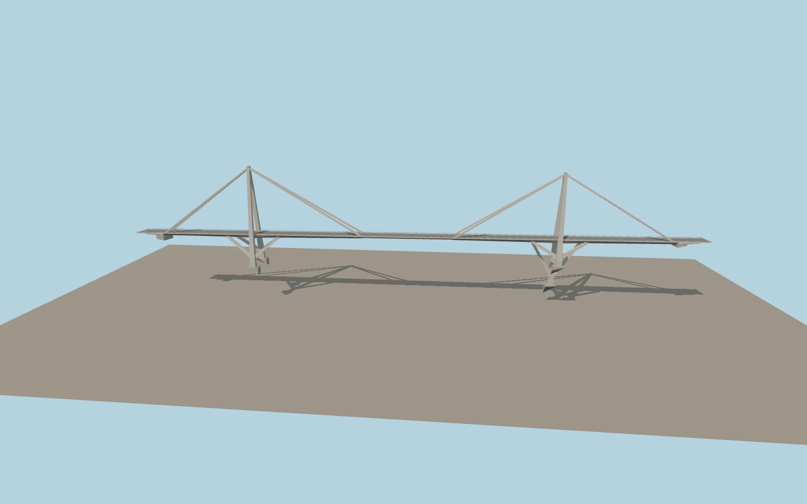

# Wadi el Kuf Bridge

Two slender concrete towers rise above the straight gorge crossing. Paired sheathed stays meet the narrow highway deck and V frames brace it from below. A shallower center segment, guardrails, curb strips and graded approaches follow the mapped road.

Run `node packages/worldgen/scripts/generate-vushtrri-stone-bridge.mjs` to rebuild the source master. Append `--check` to compare the exact bytes. Use `--ids=wadi_el_kuf_bridge` for targeted import, LOD generation and placement.

PMTiles fixes the signed highway crossing. The 525 m mapped segment includes short approaches beyond the roughly 477 m concrete bridge.

The paired towers, stay sheaths, V braces and under-deck profile follow exterior photographs. Their exact sections, footing elevations and finishes are approximations on the standard viewer terrain.

Original geometry follows the repository license. Map data is © OpenStreetMap contributors under ODbL-1.0 via Protomaps. Terrain samples are described in terrain-grid.json. Ordinary pictures stay local and are not redistributed or used as textures. Current acceptance is recorded in qa.json.
