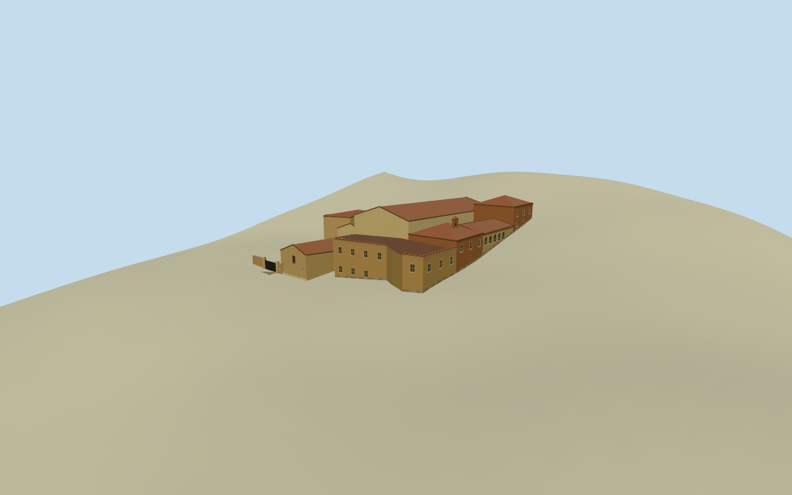

# Abbey of Our Lady of Atlas

Tibhirine Abbey on the slope above Médéa, with an ochre farmhouse gable and round gate piers, connected monastery roofs and hipped garden pavilions.

Authoring state: **review-in-qa.json**. Current completion evidence is in [qa.json](qa.json) and the [completion ledger](../../../../qualla-structures/batches/qualla-004.PROGRESS.md).

- [Abbey of Our Lady of Atlas](https://qualla.com/abbey-of-our-lady-of-atlas/)

Gate placement beside the downhill end of the attached mapped range and the subdivision of the garden elevation are inferred from the reference views and hillside geometry. Roof and storey heights are estimated.

Model covers the mapped attached masonry group. Detached agricultural and village buildings, interiors and gardens are outside this model.

Build: `node content/worldgen/source/places/sn/sn3/abbey_of_our_lady_of_atlas/models/generate-abbey-of-our-lady-of-atlas.mjs`. Add `--check` to verify exact regeneration. 5414 triangles; 6 materials; no embedded photographs.
